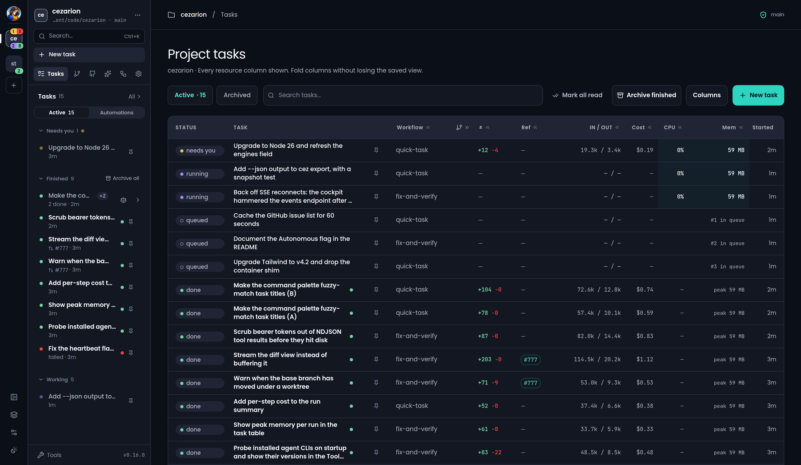
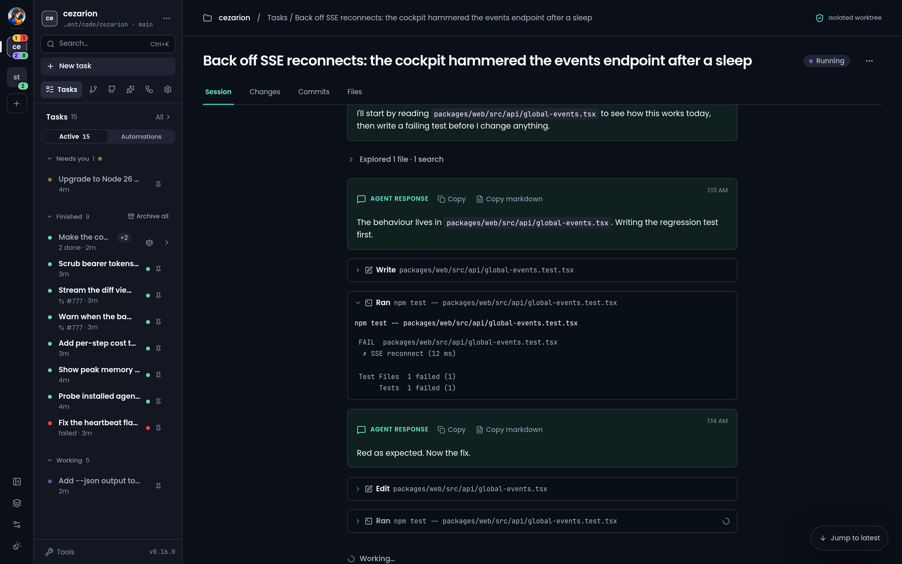
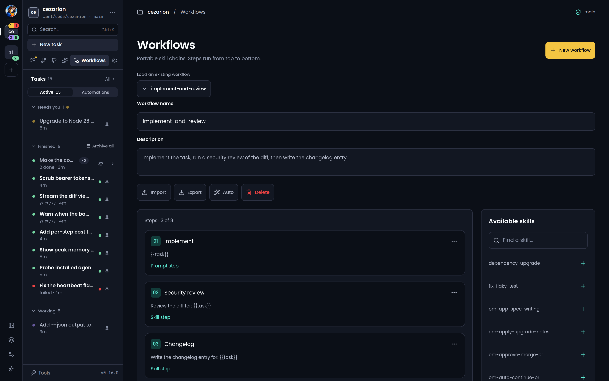
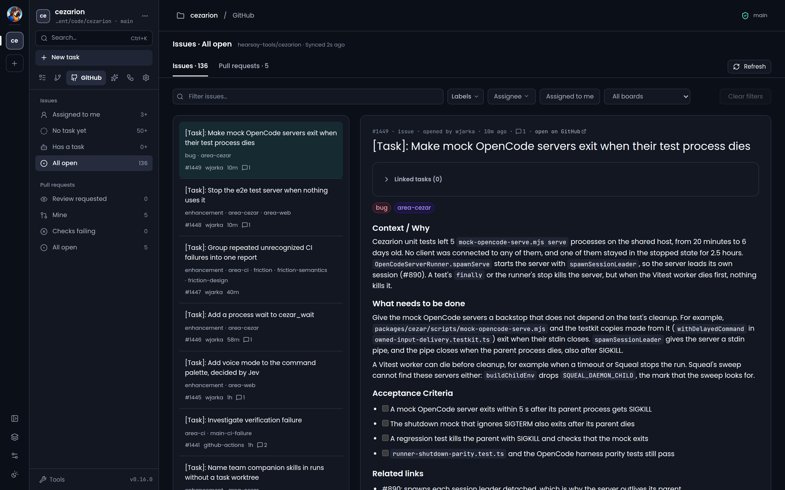

<div align="center">

<picture>
  <source media="(prefers-color-scheme: dark)" srcset="packages/web/public/cezarion-mark-dark.svg">
  
</picture>

# Cezarion

**Parallel coding agents orchestrator** — a local cockpit for running and
tracking AI coding-agent tasks in your repo.

Type a task, pick a workflow and an agent — **Claude Code, Codex, OpenCode, Cursor, pi or
OMP (OpenCode, pi and OMP experimental), or a mix of them per step** — and watch it work live: steps, tool calls,
tokens, diffs, in a browser cockpit that runs entirely on your machine.
Your CLI logins, your `gh`, your files. No accounts, no database server, no cloud.

🔥 **Fire and forget.** Queue a stack of autonomous coding and maintenance
tasks and let them run — Cezarion orchestrates them across isolated worktrees,
in parallel. Flip the **Autonomous** flag
and a run never stops to ask; it just finishes. Leave it on a VPS and you get
a dev team that's *always on* — a mobile-friendly cockpit you can check from
your phone, working your backlog while you're away.

[A look inside](#a-look-inside) · [What Cezarion does best](#what-cezarion-does-best-) · [What it solves](#what-it-solves) · [Who it's for](#who-its-for) · [Quick start](#quick-start) · [How it works](#how-it-works) · [Core concepts](#core-concepts) · [Cockpit tour](#cockpit-tour) · [Agent backends](#coding-agent-backends) · [Remote access](#remote-access-host-cezarion-on-a-server)

[](LICENSE)


</div>

---

```bash
cd your-repo
npx cezarion         # → cockpit at http://localhost:4321
```

That's the whole setup. If your `claude` CLI is logged in (Pro/Max) and `gh` is
authenticated, there is nothing else to configure. State lives in `.ai/cezar/`
inside your repo: your runs in one embedded SQLite file (`runs.db`, built into
Node: no server, no install, no config), event logs in NDJSON and journals in
Markdown. Everything except the run file you can `cat` and fix by hand.

Local npm installations have a workspace update API. `POST
/api/v1/workspace/application-update/apply` with `{}` prepares the release
advertised by health while the current server keeps running; `POST
/api/v1/workspace/application-update/restart` with `{}` then restarts it. A
successful restart updates the original global installation or ordinary npx
cache entry, so the same command uses the new version on its next launch.
Update preparation and recovery state is generated under
`~/.cezar/application-updates/` (or `CEZ_HOME`).
Pinned npx invocations, source checkouts, npm links, and hosted deployments use
their existing manual update paths. Cezarion holds its own installation lock and
npm's npx lock during promotion; a separate manual `npm install` does not honor
those locks, so avoid one while an update is preparing or restarting.

## A look inside

Click any thumbnail for the full-size screenshot.

| Orchestrate parallel agents | Watch a run live |
|:--:|:--:|
| [](docs/screenshots/task-view.png) | [](docs/screenshots/live-run.png) |
| *Run and queue tasks in isolated worktrees, with live status and resource use.* | *Every step, tool call, token and screenshot streams as it happens.* |
| **Workflow builder** | **GitHub, one click away** |
| [](docs/screenshots/workflow-builder.png) | [](docs/screenshots/github-issues.png) |
| *Stitch skills and shell checks into a reusable YAML chain.* | *Hand an issue to an agent through your own `gh` login.* |

---

## Generated inbox removed

The generated follow-up Inbox is removed in the next breaking minor release, **0.17.0**
(hearsay-tools/cezarion#1543). There is no deprecation window for this removal.
Remove `CEZ_FOLLOWUPS` from your launch environment; it no longer enables anything.
Agents receive no suggestion-generation instructions or usable `CEZ_TODOS_FILE`.
The todo API routes, `todos` SSE events, `capabilities.followups`, and task-creation
fields `generateFollowups` and `todoId` are removed. Remove those fields from scripts
and automation templates. Historical run records remain readable and resumable.
Upgrades leave `.ai/cezar/todos.json` untouched. If that file exists, export its original
contents from the project directory with:
```bash
cp .ai/cezar/todos.json ./cezar-followups-export.json
```
Old Inbox URLs show this guidance. Create an ordinary task with **New task**, or use
an issue-authoring skill to record work in your tracker. Task **Notes**, the rolling
handoff journal, **Continue**, live follow-up messages, and `cez message inbox` remain
available.
## What Cezarion does best 🏆

**On your phone:** the [iPhone and Android companion apps](docs/mobile.md) connect
to your existing HTTPS cockpit. Personal installation and device testing are
documented; agents continue running on your server.

Plenty of tools wrap a single coding agent in a nicer window — a "Codex GUI", a
conductor-style app, one-agent front-ends. Cezarion's bet is different. Three things
it does better than any of them:

- 🪶 **Genuinely zero config.** `npx cezarion` in your repo and you're running —
  no wizard, no API keys, no env vars, no schema, no database server. It rides the
  `claude` / `codex` / `opencode` / `agent` (Cursor) / `pi` / `omp` logins and the `gh` you already have, and every
  missing piece degrades gracefully instead of blocking you.
- 🖥️ **Built for a server (VPS mode).** Cezarion is made to live on a **VPS, cloud,
  or dedicated box** as an always-on janitor for your repo — headless-first, with
  a mobile-friendly cockpit you drive from anywhere. It's a coding server you can
  actually watch, not a desktop app bolted onto one machine.
- 🔀 **Parallel + autonomous orchestration.** The real edge: Cezarion runs **many
  agents at once** in isolated worktrees, **queues** the overflow, and pushes each
  one **autonomously** through skill playbooks — fire-and-forget. This is exactly
  what single-agent GUIs don't do well: they babysit one agent, while Cezarion
  orchestrates a whole team and drains your backlog while you're away.

---

## What it solves

Most "AI coding agent" tooling makes you choose between a **terminal** you can't
see into once it's running, and a **cloud product** that wants your API key, your
code on their servers, and an account. Cezarion is the third option: the agents run
locally under *your* subscription, a cockpit shows you exactly what they're doing,
and an orchestrator keeps a whole queue of them moving.

- 👀 **No visibility into a running agent.** A headless `claude` run is a black box
  until it finishes. Cezarion streams every step — agent text, each tool call and
  its result, tokens and cost per step — live, and keeps the full replay.
- 🧩 **One agent, one working tree, one thing at a time.** Kick off a second task and
  it fights the first over your files. Cezarion runs each task in its **own git
  worktree**, so two (or three) agents work in parallel without stepping on
  each other — or on the branch you're editing.
- 🗂️ **A backlog that needs babysitting.** Queue a stack of tasks and Cezarion
  **orchestrates** them: it runs up to your parallel limit and holds the rest in
  an ordered queue. Point it at a GitHub issue and it runs straight on that, so
  working the tracker down stops being a manual chore. Create ordinary tasks for
  the work you choose to run next.
- 🤖 **"Autonomous" means you still have to sit there.** Flip the **Autonomous**
  flag and a run never parks to ask — it keeps going until the task is done. Pair
  it with a **skill** (a Markdown playbook) and you've got fire-and-forget
  automation: hand off "fix this", "upgrade that", "triage these" and walk away.
- ✅ **The agent finishes and you have to trust it.** Every task's diff stays on
  its own branch: inspect it, send notes back into the same session, or push a
  **draft PR**. Auto merge is off by default; each task can opt in to merge after Done.
  Turn on the optional **review gate**
  (`CEZ_REVIEW_GATE=1` or Settings → Agents) and a finished run with changes
  waits in `review` for you.
- ♻️ **Losing a session when it fails.** Every run records its `claude` session id.
  Take it over interactively in one click (`claude --resume <id>`), or continue it
  in-process from the cockpit. After a failure, Continue tells the agent which
  step failed and gives its saved error before your message. Restart recovery
  also explains the restart when replaying a saved message. Background commands
  may have stopped; the agent is told to verify their state before restarting them.
- 🔀 **Locked into one agent vendor.** Most tools wed you to a single CLI. Cezarion
  drives **Claude Code, Codex, OpenCode, Cursor, pi and OMP** (OpenCode, pi and OMP
  experimental) through one runner seam — set a
  default, pick a backend per task, or mix them inside one workflow (implement
  with one agent, review with another) — and through **OpenCode**, **pi** or
  **OMP** you can point a run at **open-source or local models**, not just the
  big vendors. See
  [Agent backends](#coding-agent-backends).
- 🖥️ **Close the laptop and the work stops.** A local agent only runs while your
  machine is on and awake. Put Cezarion on a **VPS, cloud box, or dedicated server**
  and the cockpit becomes the GUI for an **always-on AI coding team** — kick off,
  watch and steer tasks from your laptop or **phone**, on the train or between
  meetings, while the agents keep grinding through the backlog back on the server.
- ⚡ **Setup tax.** No wizard, no env vars, no schema. Skills are Markdown, workflows
  are short YAML, and everything degrades: no `gh` → works without PRs, no network
  → local skills still load, no `.ai/skills` → the bare prompt still runs.

---

## Who it's for

- **Solo devs and small teams** who want the leverage of coding agents without
  handing their code and keys to a SaaS — the agent runs on your subscription,
  on your machine.
- **`claude` CLI power users** who love headless runs but want to *see* them,
  and review a diff before it lands.
- **Anyone with a backlog** who'd rather queue three tasks into isolated worktrees
  and pick the winners than babysit one terminal.
- **Teams with shared conventions** who want their playbooks (skills) pulled from
  a git repo, applied consistently, with zero per-project setup.

---

## Quick start

**Prerequisites:** Node 24.21.0+, at least one logged-in agent CLI — the
[`claude` CLI](https://github.com/anthropics/claude-code) (Pro/Max subscription),
the [`codex` CLI](https://github.com/openai/codex),
[OpenCode](https://opencode.ai), the
[Cursor CLI](https://cursor.com/docs/cli/installation) (`agent`),
[pi](https://github.com/badlogic/pi-mono), or
[OMP](https://github.com/can1357/oh-my-pi) — and, optionally, `git` and the
`gh` CLI.

```bash
cd your-repo
npx cezarion               # start the cockpit for the current repo
#   or: npx @wjarka/cezarion

```

The cockpit opens at `http://localhost:4321`. If the requested port is occupied,
startup exits with an actionable error before recovering tasks. Automatic port
bounce has been removed (hearsay-tools/cezarion#722): open the existing cockpit,
stop the process using that port, or choose `cez --port <free-port>` deliberately.
Use `cez --port 0` to ask the OS for an ephemeral port. If another cockpit already
serves this repository, the command prints its URL and exits with an error,
even with a different port. Different repositories can run side by side on
explicitly different ports; after a cockpit exits or crashes, its repository
can start again without cleanup.
Type a task, pick a workflow, hit **Start**. That's it.

```bash
npx cezarion run "add a --json flag to the export command"   # headless, CI-friendly
npx cezarion init                                            # scaffold .ai/cezar/
```

Both the `cezarion` and `cez` commands are installed, so once it's on your PATH you
can run either. No API key is ever used — Cezarion shells out to whichever agent
CLIs you are already logged into, `claude` by default.

> **Contributing?** [Local development](#local-development) shows how to get a
> global `cez` command straight off your checkout (`npm run install-as-command`)
> — no publish needed.

> **Just kicking the tires?** Set `CEZ_DRY_RUN=1` to run against a bundled mock
> instead of the real CLI — the whole cockpit works with no `claude` login, so
> you can explore runs and diffs offline.

### Nightly builds — help us shape Cezarion 🌙

Every night we publish the trunk to npm, so the features landing in the next
release are one command away:

```bash
npx cezarion@nightly       # everything merged as of last night
```

**Come build this with us.** Cezarion is shaped by the people who run it on real
repos: if you try a nightly and something feels wrong — a workflow that stalls, a
diff that reads badly, a runner that should exist — [open an
issue](https://github.com/hearsay-tools/cezarion/issues) and tell us. That feedback,
early, is worth more than a bug report six weeks after a release, and it is how
most of the features here got their final shape.

**Know what you're installing.** A nightly is verified (typecheck, unit suites,
packaged-CLI e2e — the same gate a release runs) but it is *not* a release: it
can be rough, a flag or a screen may change under you, and something occasionally
breaks in a way no test caught. Nothing is at risk beyond your patience — every
task runs in its own git worktree and auto merge is off by default — but if you need a
boring day, stay on the stable release. Pin a nightly you liked with its exact
version (`npx cezarion@<nightly-version>` — the cockpit prints the
version it booted, and the date in it tells you how old the build is), and drop
back to stable any time with a plain `npx cezarion`.

### Preview builds

Every green CI run also publishes an installable npm snapshot
([how it works](docs/publishing.md)), so you can try code that has not even
merged yet:

```bash
npx cezarion@dev           # current main head
```

Every pull request gets its own preview too — the CI bot posts a sticky comment
on the PR with the exact pinned version to copy-paste
(`npx cezarion@<version>-pr<N>.<run>`). Nightlies and previews are all
prerelease versions under their own dist-tags; a plain `npx cezarion` always
resolves to the latest stable release.

---

## How it works

You describe a task. Cezarion runs it as a **workflow** — an ordered list of agent
steps and shell checks — shelling out to your locally installed agent CLI
(Claude Code by default; Codex, OpenCode, Cursor, pi and OMP are drop-in
alternatives, per task or per step). Each task gets its own git worktree; the
cockpit streams every event live and leaves the diff on the task's branch for
you to inspect.

```
   you type a task
        │
        ▼
   ┌─────────────┐   optional: Plan → AI drafts a chain of steps you approve
   │  workflow   │   (agent steps + shell checks, with bounded onFail retries)
   └─────────────┘
        │
        ▼
   ┌──────────────────────────────┐     ┌────────────────────────────────┐
   │  git worktree per task       │     │  agent CLI  (your login)       │
   │  (isolated branch, parallel) │◄───►│  claude · codex · opencode ·   │
   └──────────────────────────────┘     │  cursor · pi · omp             │
        │                               │  Bash open · no prompts        │
        │                               └────────────────────────────────┘
        │  agent text · tool calls · tool results · tokens · cost
        ▼
   ┌─────────────┐   SSE (replay + live)   ┌──────────────────────────┐
   │ .ai/cezar/  │ ──────────────────────► │  cockpit  localhost:4321 │
   │SQLite·NDJSON│                         │  Tasks · Git · GitHub ·  │
   │ ·Markdown   │                         │  Skills · Workflows      │
   └─────────────┘                         └──────────────────────────┘
                                                  │
                                          read the diff → send notes back ·
                                          draft PR · finish
```

When a check fails, the workflow can loop back to an earlier step (bounded by
`max`) with the failing output appended to the retried agent's prompt. By default,
a finished run's changes stay on its branch until you act on them. A task can opt
into merging its PR after Done, subject to current-head CI and GitHub rules.
With the optional review gate on, a run with changes rests in `review` instead
of `done`.

---

## Core concepts

Three words, no jargon — **task**, **skill**, **chain**:

- 📋 **Tasks** are the unit of work. Every task is a **run**: `queued → running →
  review / done / failed / cancelled`, with a live event log, per-step token and
  cost usage, cancel/delete, and — for anything with a diff — a reviewable branch. Attach
  screenshots, PDFs, `.txt` or `.md` files to the task (paperclip, ⌘V or drag-drop;
  the agent gets each one as a real file on disk), or send follow-up messages into
  the live session while it works.
- 📖 **Skills** are Markdown playbooks. Drop them in `.ai/skills/` or
  `.ai/cezar/skills/`, or pull them from a shared **team skills repo** you name
  in `skillsRepos` (a bare git clone cached globally in `~/.cache/cez/`). There is no
  default team repo, and each team skill has its own on/off switch per project. A workflow step references one by
  `skill: <name>` and its body becomes the agent's extra system prompt — so you
  shape *how* the agent reasons without touching code.
- 🔗 **Chains (workflows)** stitch steps into a pipeline: agent steps plus shell
  checks, with bounded `onFail` retry loops. Write the YAML yourself, build one by
  drag-ordering skills in the **Workflows** tab, or press **Plan first** and let the
  AI draft a chain for your task that you review, trim and start. The built-in
  `quick-task` (one agent step) works with zero setup.

The moves that make the cockpit worth the browser tab:

- 🗃️ **Queue + orchestration.** Start as many tasks as you like: Cezarion runs up to
  `maxParallel` at once across every project (default **2**; a non-git directory
  always runs one, until its first commit lifts that limit within a minute) and
  holds the rest in a FIFO queue with visible positions (`#1`, `#2`, …). Cancel a
  queued task before it starts; the queue even survives a cockpit restart —
  everything still `queued` is re-enqueued in order. It's the orchestration layer
  that turns "one agent at a time" into a backlog that drains itself.
- 🧠 **Memory-aware runs.** Each run's whole process tree is sampled (~2 s) for CPU
  and RSS, and its **peak memory** is recorded and shown in the task table. Set an
  optional per-task **memory ceiling** (`memoryLimitMb`) and a run that crosses it
  is *paused* — freeing its tree so the queue keeps advancing — and resumes on
  demand. Event logs are append-only NDJSON and streamed rather than re-serialized,
  and live UI deltas are coalesced so they never hit disk.
- 🧹 **Bounded worktree disk.** Each task runs in its own full checkout, so a busy
  cockpit would otherwise grow without limit. Cezarion keeps only the last
  `worktreeRetention` **finished** worktrees on disk (default **10**; `0` =
  unlimited) and reclaims the rest — directory only, the `cez/<id8>` branch is
  kept, so the work stays recoverable. Once a branch's work is on the base, or
  its exact PR merged, a background sweep deletes the local branch (a task's
  merged PR branch and its unused starter too); unmerged work, open PRs and
  your own branches stay. Settings → Resources shows every
  worktree's disk use with per-row delete and a **Reclaim now** button.
- 🛡️ **You control merging.** Read a finished run's diff, type notes that go
  straight back into the agent's session, or push a `gh pr create --draft`.
  Auto merge is off by default and requires a task to opt in. The **review gate** is optional (`CEZ_REVIEW_GATE=1`, or
  Settings → Agents): with it on, a successful run with changes parks in `review`
  until you accept it. Autonomous runs always skip it.
- 🗂️ **Every project in one cockpit.** One `cez serve` hosts every repo you
  register; the desktop rail switches between them, and **All tasks** shows every
  project's tasks in one table. See
  [Multiple projects, one cockpit](#multiple-projects-one-cockpit).
- 👥 **Owned workers (opt-in).** With `CEZ_DELEGATION=1`, a task's agent can spawn
  its own tracked workers — on the same or another runner — message them, and
  collect their diffs; you still review the result. See
  [Owned workers](#owned-workers-opt-in).
- 📱 **Runs on your coding server, drives from your pocket.** The cockpit is a
  responsive web app streaming over SSE, so the box running Cezarion can be a
  **VPS, cloud, or dedicated server** you never sit in front of. Point a browser
  — laptop or **phone** — at it and run an **always-on coding team** on the move:
  start tasks, watch them live, and review their diffs from anywhere.

---

## Cockpit tour

Task and project views share one browser window and live updates over Server-Sent Events:

| View | What's in it |
|---|---|
| **Tasks** | Every task with its status, live event stream (agent text · tool calls · tool results · pasted/generated screenshots and file attachments), tokens and cost. Continue, cancel, open in terminal (`claude --resume`), review the diff, or push a draft PR. |
| **All tasks** | Every *registered project's* tasks in one table, filtered and grouped by tag, project, status or workflow — see [Grouping connected repositories](#grouping-connected-repositories-tags-and-the-all-tasks-page). Appears once a second project is registered. |
| **Git** | Branch, working-tree status, diff vs HEAD, recent commits (click one for its inline patch + GitHub link), and the configurable base branch that worktrees fork from and PRs target. |
| **GitHub** | Open issues and PRs of the repo's origin, read through your logged-in `gh`. Hand an issue straight to the agent — pick a workflow and skills, one click runs it. |
| **Skills** | Local skills plus any team skills repos you configured, each team skill with a per-project switch, and a rendered body + prompt preview. Refresh pulls the latest from the remote. |
| **Workflows** | Build a chain by drag-ordering skills, save it as portable YAML, import/export, or delete. Built-ins always come back. |
| **Settings** | Appearance (dark/light theme, accent, density), agent backends, notifications, and the skills catalog. |

The cockpit is a React app served pre-built from the package — `npx cezarion`
still means no build step and no dev server on your machine — with a dark/light
theme, a ⌘K command palette, and bookmarklets that launch a task straight from
a GitHub page.

GitHub issue and PR lists refresh every 60 seconds while mounted in a foreground browser tab.
Automatic reads retain the server's 60-second cache: while online and visible, upstream edits
appear within 120 seconds plus request time. Revisiting or focusing stale data fetches again;
server reconnects invalidate cached lists. Hidden and unmounted lists do not poll. **Refresh**
bypasses the server cache immediately and refreshes the selected thread too.

---

## Multiple projects, one cockpit

One `cez serve` hosts **every repo you work in**, not just the one you started
it in. Each repo Cezarion boots in registers itself in a per-user registry at
`~/.cezar/config.json` — the workspace file that also holds the global knobs
(the parallel cap, the memory ceiling, the browse root, and the checkout root). Nothing is added to
the repo: per-project state stays exactly where it was, in that repo's
`.ai/cezar/`.

Every view is project-scoped:

```
/p/<projectId>/            tasks · git · github · skills · workflows · settings
```

`<projectId>` is a slug derived from the folder name (`my-app`, then `my-app-2`
on a collision), and `/p/default/…` always means the project Cezarion was started
in. The desktop rail selects the project. Its sidebar shows the project header,
view tabs and task list, ordered **Needs you → Finished → Working**.
Pins stay first within their status section and do not spend the default ten-row
budget; Finished takes priority over Working when that budget fills up. Each
section starts expanded and folds independently using its heading (click, Enter
or Space). Folding is remembered per browser, project and section, separately
from folding a project. Folded headings keep full task counts and attention
indicators, including tasks outside the visible row limit. These controls work
in the mobile drawer too. **Archive all** appears only on Finished and archives
all eligible unpinned tasks, including hidden rows; individual archive actions
and Undo remain available. Archived keeps its existing history view.
Inbox and Automations appear in More views when enabled. The project menu
offers Mark all read and project settings; local mode also offers Open in and
Copy path. Active/Archived remains below the Tasks heading. The new-task
composer names the project it will run in.

**Adding a project** — the **+** button on the desktop rail (or in the mobile
navigation drawer):

- ✨ **New project…** creates a git repository with one empty commit in the checkout
  root and registers it. Optionally — only when you switch it on — it also creates a
  **private** GitHub repository under your account or one of your organizations, empty or
  from a GitHub template. If GitHub setup fails after the repository exists, the local
  project is kept and the dialog shows the command that finishes it. A hosted cockpit
  creates local projects only.
- 📂 **Open local folder…** browses from the configured browse root
  (**Settings → Projects**, default `~/`) in a folder picker and
  registers the folder you pick.
- ⬇️ **Clone from GitHub…** clones with your logged-in `gh` into the checkout
  root (**Settings → Projects**, default `~/cezar/projects`) with live progress,
  then registers the clone. Close the dialog and the clone is killed and its
  partial directory removed. For a SAML-protected organization, follow **Authorize
  this GitHub organization**, authorize in GitHub, then return to retry once (or
  choose **Retry clone**). Original errors remain available under **Error details**.
  Clones use HTTPS and save the GitHub CLI credential helper in the new repository
  so later pushes use the same organization grant, even if `gh` prefers SSH.

Removing a project (**Settings → Projects**) drops the registry entry only — the
repo and its `.ai/cezar/` are never touched, so re-adding it later finds all its
tasks intact. The project Cezarion is currently serving can't be removed: it
re-registers itself at the next start.

**From the terminal** — the same registry, no cockpit required (handy over ssh):

```bash
cez projects                      # list: id, branch or status, path, tags
cez projects add ~/code/api       # register a folder (defaults to the current repo)
cez projects remove api           # drop the registry entry; the repo is untouched
cez projects tag api storefront backend     # set the grouping tags (no tags clears them)
```

These read and write `~/.cezar/config.json` directly, so they work with the
server stopped, and `CEZ_HOME` selects which workspace they operate on.

Settings split along the same line: **General** (the project's folder, its
registry facts, its parallel-task ceiling, and Remove), **Agents**, **Agent config**,
**Worktrees**, **Sidebar**, **Bookmarklets** and **Prompt templates** describe one
repo and live under `/p/<projectId>/settings`; **Appearance**,
**Notifications**, **Resources**, **Skills**, **Agent accounts** and **Projects**
are yours or the machine's and live at `/settings/global`.

**Settings → Sidebar** controls this project's task rows on desktop and mobile.
Set **Overall**, **Needs You**, **Finished**, and **Working** to a positive whole
number or **Unlimited**. Defaults are 10 overall and Unlimited for each section.
The overall budget is allocated in section order (Needs You, Finished, Working),
and each section must also fit its own limit. Unlimited removes only its selected
constraint. Pinned rows and groups containing pins bypass both budgets; a grouped
task counts as one row. Archived uses only the overall limit, with no pin exemption.
Save applies the preferences to this project and keeps them after a reload.
Refreshed preferences update an untouched form; unsaved edits stay in place.
Malformed stored sidebar limits fall back field by field to these defaults,
while valid limits and unrelated preferences are preserved.

On desktop, Settings replaces the sidebar task list with two groups: **This project**
and **Global · every project**. Each group includes General and its available sections;
the current section is highlighted, and the main page shows its content. On mobile,
the section picker and General page's section cards provide navigation.

The GitHub sidebar groups **Issues** (Assigned to me, No task yet, Has a task,
All open) and **Pull requests** (Review requested, Mine, Checks failing, All open).
Selecting a filter updates the URL, so reloading keeps that selection. The issue
list, detail pane and Hand to agent action stay in the main area. On mobile, the
GitHub tab opens the filter screen; selecting a row opens its list.

Has a task and No task yet use issue references from this project's non-archived
tasks, excluding references to other repositories. The list loads 50 rows at a time
and loads the next page as you scroll toward its end. The tabs and All open show
GitHub's exact open totals. A preset count shows a `+` while more pages remain
unloaded, and a search count shows one when the search reaches its result limit;
an unavailable count is not shown as zero. Filtering by search, label, assignee or
board narrows the loaded rows; while it is on, the next page loads only when you press
Load more.

The `body` field on `GET /api/v1/github` list rows is deprecated. It is still sent,
and a later minor removes it; read an item's body from the comments route's `detail`. Views without their own navigation still show tasks in the sidebar.

Open an issue to see **Linked tasks (N)** beneath its heading. Each row opens a task
in the current project and shows its title, status and date, newest first. Archived
tasks remain listed with an **Archived** label, so diagnosis and implementation
sessions are both reachable.

The Git sidebar lists **Task worktrees** that still exist on disk, including retained
worktrees from finished tasks. Each row shows its branch, task title, status and
available diff counts, and opens that task's Changes tab. Reclaimed worktrees disappear
from the list. Changes, Commits and Branches remain tabs in the main repository header.
On mobile, the Git tab opens the worktree list; **Open repository** opens the repository
view, and **Back to worktrees** returns to the list.

### Grouping connected repositories: tags and the All tasks page

Work rarely stops at a repo boundary. A storefront is an API, a web app and a
design system; a platform is a handful of services plus the infra that runs
them. **Tags** are how you say so, and **All tasks** is where saying so pays off.

**Tag a repo** in **Settings → Projects**: type into the *Tags* cell on its row
and press Enter (comma works too; the × on a chip, or Backspace in an empty
field, removes one). The field **autocompletes from the tags already used in the
workspace** — click the field to see them all, arrow keys and Enter to pick —
which is what keeps the second repo landing on the first one's spelling instead
of inventing `store-front` next to `storefront`. Anything not on the list is
just typed. A tag is a free-form label — `storefront`, `infra`, `client-acme` —
and a project can carry several, because a repo can belong to more than one
piece of work. Tags are trimmed, deduplicated case-insensitively (`API` and
`api` are one tag) and stored in `~/.cezar/config.json` beside the rest of the
registry, so they are yours and this machine's, never something added to the
repo.

**All tasks** — the layers icon on the desktop rail, `/tasks`, or `⌘K → All tasks` —
then shows every registered project's work in one table:

- **Filter** by tag, status and workflow. Tags are one-click chips; status and
  workflow are searchable multi-selects. Every facet ORs inside itself and ANDs
  across, so *"anything running or waiting in storefront or infra"* is one set
  of clicks. Each option carries how many tasks it would leave, so a filter that
  would empty the table says so before you click it. The search box matches
  title, project, workflow, branch and tags.
- **Group by** tag, project, status or workflow — click the pressed one again to
  ungroup. Grouping by tag is the reason tags exist: three repos tagged
  `storefront` become one section, and a repo tagged twice appears under both —
  it genuinely belongs to both.

The filters, the grouping and the Active/Archived tab live in the **URL**, so a
filtered view survives a refresh, pastes into a chat, and sits in a bookmark —
`/tasks?tag=storefront&status=running&group=tag` is a link to exactly what you
were looking at. Only what you changed shows up: Active is the default, so the
Archived view is `?archived=1` and a normal link carries no key for it.

Each row shows **every** PR and issue it references — a task opened on an issue
that landed a PR shows both — plus its cost and live CPU/memory, and can be
marked **read/unread** (the eye) or **archived** (or restored) right there. Every task title, project name and project group heading links into that
project, so the thread, its diff and its worktree are one click away and stay
exactly where they were. Returning to a long thread restores its saved row measurements
once the replay has rebuilt the same ordered messages, keeping the same content in view.
Scrolling, jumping to the latest message, or loading different history takes ownership
from that restoration; a thread left at its live tail follows the current tail.

There is deliberately **no project filter**: narrowing this page to one project
is that project's own Tasks page, which is a better version of the same answer
(live updates, the full column set, the composer). So picking a project *leaves*
for it rather than turning the global view into a worse local one.

Nothing else in Cezarion reads tags, on purpose: a tag is a lens, not a permission,
a queue or a routing rule. Removing one changes what you see and nothing else.

> The page reads a workspace-wide index capped at the newest 200 tasks per
> project — it says so, and names the projects it capped, rather than showing a
> short list as if it were complete. Older tasks are always in that project's own
> Tasks page.

**Old page URLs keep working.** Every unprefixed page path — `/`, `/tasks/<id>`,
`/settings` — still answers, bound to the project Cezarion was started in; the
cockpit redirects flat paths to their `/p/<boot>/…` twin, so existing bookmarks
and bookmarklets need no change. The HTTP API is the exception: it moved to
`/api/v1/…` (see the CHANGELOG), so a script that calls it needs the extra
segment.

> **Hosted cockpit?** The folder picker is confined to the independent browse
> root. Set `CEZ_BROWSE_ROOT` narrowly before first boot (or save it in
> **Settings → Projects**) when a remote viewer should not enumerate the host's
> whole home. Clones continue to use the separate checkout root.

---

## Waiting for PR checks, merges and timers

An agent waits on something outside its turn with `cezar_wait`. With `kind: "pr"` and
a GitHub PR URL in `pr`, Cezarion watches the PR outside the model: its checks
(`until: "checks"`, the default) or its merge (`until: "merge"`). The optional
`timeout_seconds` defaults to 1,800 and accepts 1–7,200. With `kind: "timer"`,
`seconds` (60–7,200) and an optional `note`, Cezarion wakes the agent at that time and
hands the note back. No authored configuration or worker delegation permission is
needed. A PR wait requires `gh`, access to the repository, and a supported GitHub
host; GitHub Enterprise hosts must already be recognized by the forge/auth
configuration. Tool startup itself makes no GitHub request. With **Monitoring
wake-up** turned off in **Settings → Resources**, `cezar_wait` refuses a timer
(`timers_disabled`); once the automatic-wake budget of 40 is spent, it refuses one
with `wake_budget_spent`, and a run with nothing else to wait on waits for you. The
budget is kept on the task, so a cockpit restart keeps it; a message from you or a
Continue starts it again.

A CI wait stays pending while any GitHub Actions workflow run on its captured
head commit is incomplete, even when a rerun temporarily hides that run's checks.
It checks again every 30 seconds within the original deadline. Once those runs
complete, it reads the checks again to decide the result. A result describes what
GitHub reported; it does not predict workflows that have not appeared yet or grant
merge approval.

A merge wait (`until: "merge"`, hearsay-tools/cezarion#1425) reads the PR's state at
once and then every 30 seconds within its deadline. It ends as `merged` only when
GitHub reports the PR merged, with the merge time and merge commit when GitHub gives
them, and as `closed` when the PR closed without merge. Green checks keep it open,
and so does a new head commit. A merge wait holds none of the four watcher slots, so
long merge waits never delay a checks wait. By default both targets also end as
`conflicting` when the PR has merge conflicts. Set `wake_on_conflict: false` when the
agent watches a PR it does not own, such as another agent's PR its work depends on:
it cannot resolve those conflicts. With `until: "checks"`, GitHub often runs no
workflows on a conflicting PR, so such a wait usually ends as `no_checks` or at its
deadline. A checks wait and a merge wait on the same PR are two waits.

The agent asks you with `cezar_ask`, a card of one to four questions in the ask
format. A question with two to four options shows them as choices; a question without
options is open, and the card shows a text box for your answer. The task reads Needs
you once the turn ends, and your next message answers it. `cezar_wait` takes PR waits,
worker waits and timers only, and points an agent that asks it for a human wait to `cezar_ask`. A run
has one question to you at a time, and the agent cannot cancel it once you have seen
it. A native question opens the same kind of wait. When the work is
done and verified, the agent calls `cezar_done` (an optional `summary`), and the task
finishes at the end of that turn: its open waits are cancelled and the summary is
written as a note. `cezar_done` refuses while owned workers are live or uncollected,
a worker question is unanswered, a question to you is still pending, or the step is not
the workflow's last, and says what to do first. An
autonomous task does not wait for you until its automatic-wake budget is spent.

A run can have several waits open at once, up to 16. Each answer carries the
wait's id, its absolute deadline and the list of waits still open, and
`cezar_cancel_wait` closes one by its id. The agent ends its turn to wait, with no
marker required. The run is then `waiting`, and the pill reads **waiting for CI**,
**waiting for merge** or **monitoring** rather than Needs you. The header lists every open wait: **Waiting
for CI — owner/repo#N** or **Waiting for merge — owner/repo#N** with a PR link and the deadline, or **Next automatic check**
with its time and note. **CI result ready — waiting for capacity** means the
observation is owed to the agent and its wake turn has not started yet. A run parked
on CI or a timer keeps its agent slot, a monitoring slot when one is free, so the
wake usually starts at once. Claude's `ScheduleWakeup` opens a timer in the same list.

Every agent session needs these tools. Cezarion starts a private local socket for them,
in the system temporary directory, when the first session of a cockpit launches. If it
cannot start, for example because that directory is full or not writable, the task fails
before the agent starts. The error names the cause and the fix: free space or fix the
permissions, then Continue the task. A task woken by a wait retries with the usual backoff.
The cockpit and other tasks keep working, and the next launch tries again.

Cezarion reports passed, failed, cancelled or skipped checks, no checks, changed head,
timeout or an operational error. It watches the registered commit: a new PR head
is reported separately, and the agent decides whether to wait again. The first
observation runs immediately. Later check-status and PR-head polls run every 30
seconds, and no setting changes that interval. Four watchers run concurrently;
queued waits retain their original deadline. Results are bounded
observations, not merge approval or evidence that every expected workflow appeared.
The agent still decides its next action; CI success never completes the task or
accepts review. A wait ends only when its own result arrives, its deadline passes,
or someone cancels it: the agent with `cezar_cancel_wait`, or Cezarion when the task
is stopped, finished, cancelled or deleted. A human message wakes the agent without
closing any wait, and every delivered turn ends with a list of the waits still open.
CI never answers a pending human question. If the agent's session fails or closes while a
result is owed, Cezarion retries the delivery after 15 and then 30 seconds; a third
failure marks the task failed and keeps the result. Continue delivers it, and Stop
discards it and leaves the task failed.
Controller recovery can replay an
observation after an ambiguous delivery checkpoint, identified by its stable
lifecycle input ID.

The deprecated `cezar_wait_for_ci` tool was removed (hearsay-tools/cezarion#1236):
call `cezar_wait` with `kind: "pr"` instead. `kind: "ci"` itself was replaced by
`kind: "pr"` (hearsay-tools/cezarion#1425) and is refused with a message that names
the new spelling.

The adapters are bundled for Claude (including `claude-cli`), Codex, OpenCode,
Cursor, Pi and OMP. Internal socket/capability environment values are runtime wiring,
not settings to create or share. If the tool is unavailable or denied, its error
is surfaced while ordinary tasks continue. See [the CI-wait protocol](AGENT_PROTOCOL.md#ci-wait-tool-contract-474)
for limits and the executable harness verification required before release.

## Discover runners and models

Inspect the same host catalog the cockpit uses before selecting a runner or model:

```sh
cez discover runners
cez discover models --runner=codex
```

Both commands return JSON. `runners` lists connection status (`connected`, `disconnected`, `not-installed`, or `unknown`) and enablement, with `scope: "host-default-account"`. Model rows include `effortLevels` when the runner advertises them: an absent field means unknown; an empty array means no advertised levels. Omit `--effort` when spawning to keep the existing default. Model responses retain `source`, `stale`, and any unavailable `reason`; discovery never invents model IDs or effort support.

For operators, the command finds the running cockpit for the current checkout; `--repo`, `--url`, and `CEZ_URL` work as they do for `cez task`. A missing cockpit returns an error and never starts a server. Inside a parent delegation session, the same command uses that session's authenticated controller, including headless runs. It rejects `--url` and `--repo` in that context and never falls back to a public cockpit after an authentication failure. Owned workers cannot use the private discovery route.

The catalog describes host default accounts, not every named account or the selections permitted by a task's model locks and workflow pins.

## Parallel variant removal

Parallel variants (×2/×3) are removed in the next breaking minor release (0.17).
The owner chose immediate removal without a deprecation window
(hearsay-tools/cezarion#1542). The composer starts one task. `POST /api/v1/runs`
refuses `variants: 2` or `3` with `400`; it never turns them into one candidate.
The old `variants: 1` spelling still means an ordinary run.

The compare page and its group routes are retired too (hearsay-tools/cezarion#1760).
Historical `groupId` and `variant` fields remain stored, and old variant runs list as
ordinary tasks. Old `/compare/:groupId` links, including project-scoped links, open the
task list. No retirement migration deletes runs, branches or worktrees;
normal retention and explicit cleanup still apply. Saved multi-candidate drafts and
automations offer **Use one task** before saving or launching. A saved automation with
`task.variants > 1` reports an error on launch; edit it to remove that field or set it to `1`.

For explicit comparison, ask a task: “Spawn two owned workers from the same committed
baseline. Try a minimal change and a structural approach. Collect both results and
compare their diffs. Show me the commits to choose from before integration and cleanup.”
The parent uses `cez worker spawn`, `collect` and `diff`, reviews the chosen commits,
integrates them with Git, then uses `cez worker destroy` for verified cleanup. Read
`diffSnapshot` from an available collection's JSON file rather than applying that file
as a patch. Collect each worker's latest settled revision before finishing. Owned workers
keep their ownership, isolation, resource limits and Git cleanup safeguards. There is
no one-click comparison page, automatic winner selection or automatic loser cleanup.

## Owned workers (opt-in)

Start the cockpit or a headless task with `CEZ_DELEGATION=1`. Each eligible parent session receives the absolute bundled Node/CLI invocation and its own environment credentials; no `cez` installation on the agent's PATH, config file, separate daemon, or remembered port is needed. If the private listener cannot start, ordinary tasks keep working without delegation tools. `.env` is never loaded automatically.

The provisioned command has these forms (the session instructions supply the absolute invocation):

```sh
cez worker spawn --baseline parent-head --request-id <UUID> 'Implement the assigned change'
cez worker spawn --baseline parent-head --request-id <UUID> --runner codex --effort high --context-file ./selected-context.txt 'Review the parser'
cez worker spawn --baseline parent-head --request-id <UUID> --workflow review 'Review the parser change'
cez worker list                         # All own workers, revisions and cleanup resources (fetches pages automatically)
cez worker inspect <worker-id>
cez worker steer <worker-id> 'Consider this additional constraint'
cez worker diff <worker-id>
cez worker collect <worker-id>
cez worker wait <worker-id> --mode one --timeout-seconds 600
cez worker wait <first-id> <second-id> --mode any --timeout-seconds 600
cez worker wait <first-id> <second-id> --mode all --timeout-seconds 600
cez worker cancel-wait <wait-id>
cez message request <recipient-run-id> 'Please check this decision' --id <message-UUID>
cez worker resume <worker-id> 'Correct the returned result' --id <new-message-UUID>
cez message progress <recipient-run-id> 'Parser tests pass' --id <message-UUID>
cez message follow-up <recipient-run-id> 'Include empty input' --id <message-UUID> --request-id <request-UUID>
cez message reply <recipient-run-id> 'Checked; empty input is covered' --id <message-UUID> --request-id <request-UUID>
cez message conversation <recipient-run-id>
cez message wait --request <request-UUID> --request <another-request-UUID> --mode all
cez message wait --peer <task-id> --timeout-seconds 1800   # Wake on that peer task's next message, or when it settles
cez message inbox
cez message tasks --all
cez message cancel-wait <wait-id>
cez message cancel-request <request-UUID>
cez worker stop <worker-id>
cez worker destroy <worker-id>
```

Use `cez message --help` for messaging commands. Use `cez worker --help` to list worker operations and flags, or `cez worker <operation> --help` for one operation. Explicit help prints human-readable text and exits successfully without an active delegation session. Commands otherwise return bounded JSON and a nonzero exit on failure or incomplete cleanup. Spawn requires a committed baseline (`parent-head` or an explicit ref) and pins its SHA at acceptance; dirty parent edits are excluded. Optional `--context '<text>'` or `--context-file <UTF-8-file>` supplies selected context, not the parent's conversation. The two flags are mutually exclusive, and combined task/context text is limited to 100,000 characters. The API also accepts up to 32 pinned-baseline file or parent-attachment references, with at most 8 MiB of copied attachments. Inspect reports worker-local input locations. Reuse a request ID only with the same task, baseline, context, runner, model, effort and workflow when retrying a lost response. `--runner` and its alias `--backend` count as the same field, so a retry may switch spelling. A parent holds at most 32 outstanding workers: accepted, live, or not yet verifiably destroyed. A verified destroy (`cez worker destroy`, or **Clean up** on a finished worker in the cockpit's Workers list) frees a slot; incomplete cleanup keeps its slot until a retry completes. A parent can create at most 1,024 workers in total; past that, start a new task. These limits bound disk resources and runaway spawning, not spending: a worker can be resumed with Continue, and destroying it does not undo charges already made. Cost stays bounded by `maxParallel` and by stopping the parent. There are at most 32 undelivered steering messages per worker.

An incomplete destroy reports the remaining resources and a reason. Cezarion retries that recorded request after a delay, including after the project's context recovers on server restart. It removes the owned checkout only after process termination and ownership are verified. If the reason persists, inspect the worker process, Git worktree lock and ownership receipt; correct the blocker and use `cez worker destroy <worker-id>` or the cockpit Destroy action to retry immediately. Cezarion leaves ambiguous or replaced resources in place for operator review.

`--workflow <name>` runs a catalog workflow inside the worker: the built-in `quick-task` or any `.ai/cezar/workflows/*.yaml` by name, with its agent and check steps, `skill:` bodies and `onFail` loops, so a repo's `review.yaml` becomes a dedicated reviewer. Omitted `--workflow` runs `quick-task` exactly as before. `--runner`, `--model` and `--effort` fill only the steps that leave those fields unset; a step's own `allowedTools`/`bashAllowlist` narrow the parent's grants and never widen them. An unknown name is refused. Agent steps may mix runners: at spawn every agent step is resolved and pinned separately, so an implement-with-codex, review-with-claude chain runs each step under its own runner, account, model, effort and grants. A step's optional `agentProfile` names the account it runs under (an id the registry does not know is refused); same-runner steps otherwise inherit the parent's account and other runners resolve their project/default one. Run-level columns show the first agent step.

Explicit default-account model pins are checked against a fresh, nonempty host catalog after account/model resolution and before a worker is created. Named accounts retain existing validation because a default-account catalog cannot disprove their model access. A miss returns `invalid_input`, available models with advertised efforts, and other runners listing the requested ID in `modelChoices`. Empty, stale, or unavailable discovery leaves existing selection validation in place. Accepted retries and omitted model defaults are unchanged.

Omitted `--runner` inherits the parent's active runner. Same-runner workers inherit omitted model/account/effort; `--runner <claude|codex|opencode|pi|cursor|omp>` selecting another runner resolves that runner's project/default account and model without forwarding another provider's settings. `--backend` is a permanent alias of `--runner`; giving both with different values is refused as `invalid_input`. Worker `inspect` and `collect` still report the selected runner in a field named `backend`. `--model <model>` selects a supported model, subject to existing locks. `--effort <low|medium|high|xhigh|max>` pins reasoning effort on same-runner and mixed-runner spawn; omitted `--effort` still inherits the parent pin on same-runner spawn and drops it on mixed-runner spawn. Accepted identity and grants remain fixed across queuing, restart and Continue, including explicit empty grants. Changing or deleting an account registry entry does not rebind a worker. Missing accepted identity evidence or account homes, incompatible Claude state-file layouts, and conflicting later model locks refuse execution explicitly. Credentials and vendor configuration are never copied; each worker receives its own delegation credential, and unspecified native models stay unspecified.

Wait registers immediately. End the parent turn to release scheduler capacity; Cezarion resumes it on a selected settled outcome or the finite deadline. `any` is the default, `one` requires exactly one worker, and `all` waits for every selected worker. Review, completion, failure, cancellation with proven termination, and destruction are outcomes. Timeout defaults to 600 seconds (1–1800 accepted). `cancel-wait` is idempotent for the retained wait ID and cannot cancel a newer wait. Timeout and wait cancellation report partial outcomes and unresolved workers, never cancel workers, and never automatically re-wait. Steering is attributed agent input and cannot answer a pending human question.

Parents and owned workers can converse in both directions; a worker may address only its parent. `send --kind request` opens a reply obligation whose ID is the message ID; `send --kind progress` (or `progress`) does not. Follow-ups clarify an existing request; only an explicit correlated `reply` settles it as replied. Retry a message with the same ID and exact payload, including deadline duration; changed payloads are rejected. Acceptance, provider delivery, reply, and task completion are separate facts, visible in the task transcript and `conversation` JSON.

Messages allow 100,000 characters each, with at most 32 undelivered inputs per recipient, 1,024 messages per family, and 32 pending requests. Request deadlines default to 600 seconds, configurable per message with `--timeout-seconds 1–1800`. Request waits use the same limits and `one`/`any`/`all` modes as worker waits, and each run has one active wait. Incoming conversation can interrupt a parked wait without settling its requests. `cancel-request` cancels an obligation; `cancel-wait` only stops waiting. Completion without a reply, failure, cancellation, destruction, timeout, or sender closure settle obligations distinctly. Late replies remain visible without reopening them.

Messages reach a live recipient as soon as they are accepted, including mid-turn: Claude, Codex, Pi, OMP and OpenCode steer them into the running turn, and the model reads them at its next step. Cursor delivers at the turn boundary, because a second prompt would cancel its running turn. Pending conversations go together, in order, up to 32 messages and 100,000 formatted characters per batch; a single valid message is never split. Every message keeps its ID, sender, delivery receipt and request outcome; receipts show queued, delivered and read (when the agent's harness can tell) separately. A pending human question holds messages until it is answered, then they follow right behind the answer. The thread's Details distinguish creation, delivery confirmation and event-recording times.

Sending a message to a review or terminal participant reports `not-delivered` and `continuation-required`, with the reason and next command; the CLI exits 1. An active parent can use `cez worker resume` to continue its settled done/review/failed worker with that message as the new instruction. No human Continue is needed for this parent-controlled action. A retry with the same payload and ID never creates another continuation; resuming after a rejected message requires a new ID. Stopped or destroyed workers need a new worker. Workers cannot resume parents, and conversation never answers a pending human question. Durable IDs deduplicate accepted queue entries and event replay, but a crash between provider acceptance and its durable delivery checkpoint can leave transport delivery ambiguous; this is not an exactly-once execution guarantee.

Collect returns the worker's execution revision, status/outcome, `settled` and `partial` flags, and typed availability for assistant summary, HEAD, bounded diff and artifact descriptors. Missing evidence is explicit; running output is partial. An available `diff.path` points to a **JSON result file** containing `{ result, diffSnapshot }`; its `diffSnapshot` field holds the patch. Read and review that field before applying any changes. The latest collected result is stored under the parent and survives restart. Collection acknowledges observation, not Git integration or successful work. Review desired worker commits and deliberately integrate them into the parent before destroying their worktrees/branches; there is no automatic merge.

Parent completion requires collection of every worker's latest settled execution revision. A worker Continue invalidates older readiness. An early completion attempt waits for outstanding workers and wakes the parent to inspect/collect; it does not silently finish on wake. While workers remain live, markerless replies, completion timeouts, and repeated premature completion park the parent as monitoring with the existing capped wakeups. Once workers settle, repeated completion without collecting their results retains attention. Human Finish also refuses unresolved/uncollected workers. If the parent is already under review, Continue the parent first, then Continue its worker. Human questions remain authoritative.

Stop requests cancellation; `stopping` does not prove termination. Destroy checkpoints obtainable results, waits up to 30 seconds for proven termination, and removes only verified owned resources. An `incomplete` response lists remaining resources; resolve the cause and retry explicitly. Cleanup order is: collect/integrate desired results, destroy owned resources, explicitly delete child histories through the cockpit/API, then delete parent history. Parent-owned summaries and bounded diff snapshots remain until parent deletion, including after child-history deletion; general artifact bytes are not archived. Branch/path strings and SHAs become historical descriptors after removal, not promises of available Git objects or files. The human cleanup endpoint `POST /api/v1/p/<projectId>/runs/<worker-id>/worker-destroy` stays available when delegation is disabled. The CLI bounds each HTTP request to 45 seconds and rejects endpoint/auth/origin overrides and redirects.

Provisioned root tasks and workers may use native subagents, and each mechanism has its own purpose. Use native subagents for work that needs no separate worktree: research, code reading and focused analysis, for example a subagent that reads the parser and summarizes its error handling. Native subagents need no worker creation, worktree, collection or destruction. Use Cezarion workers for work that needs its own worktree, its own commits or a tracked lifecycle. Workers may use native subagents too, but cannot spawn Cezarion workers. An agent may message its own subagents with its runner's tools; it reaches another Cezarion task only through `cez message`. Where a runner's native tool for reaching another session is separate from subagent messaging, a per-run adapter control turns it off: Codex's cross-thread message board, and an OpenCode plugin that refuses a `task` call whose `task_id` names a session outside the caller's own session tree. Claude sessions refuse messages from other sessions on every launch. Known limitations: a Claude session Cezarion starts can still list and message Claude sessions that Cezarion did not start, and sessions on other machines; an OpenCode session that an older Cezarion created under delegation keeps its `task` deny on Continue and restart recovery, because OpenCode cannot remove a session permission rule (new OpenCode sessions allow subagents). See [the backend capability table](AGENT_PROTOCOL.md#governed-delegation-controls-d1) for tested versions and exemptions. With delegation disabled or unavailable, ordinary tools/settings stay unchanged. The listener binds to `127.0.0.1`, including hosted cockpit mode. Its credentials authorize only the parent's own workers through that listener. This is cooperative local-agent supervision; same-user unrestricted shell and custom tools are not hard isolation. Workers cannot spawn Cezarion workers or message peers through Cezarion. Review remains a human gate with no automatic acceptance. Never read, echo, forward, or persist the generated token.

## From the terminal: `cez task` and `cez message`

`cez task` starts, watches and steers tasks **in the running cockpit** from a shell — for you, or
for a bot driving one. Every command prints one JSON object and exits with a code the caller can
branch on, so nothing has to parse prose. It never starts a server: it finds the cockpit whose
project registry holds this checkout (ports 4321–4370; a task worktree resolves to its parent
project), or you point it at one with `--url` / `CEZ_URL`.

```text
cez task [--url <origin> | --repo <dir>] <operation> …
```

The shared `--url`, `--repo` and `--help`/`-h` flags also work before the operation;
`--url` and `--repo` accept both `--flag value` and `--flag=value`. A shared flag repeated
before the operation or on both sides is a usage error. Operation flags stay after the
operation. `cez task --help <operation>` shows that operation's help without discovery.
An explicit `--url` wins over `CEZ_URL`; `--repo` selects the checkout to discover.

`cez task send` is human input. It can answer a pending human question. It refuses
inside a task (`CEZ_TASK_ID` is set). Agents use `cez message` for task messages,
including peer and parent/worker conversations; see [Owned workers](#owned-workers-opt-in).

```bash
id=$(cez task start --task-file - <<'EOF' | jq -r .id
Fix the `cez task` docs. Keep $(example) and "quotes" literal.
EOF
)
cez task wait "$id" --timeout-seconds 900                     # 0 done/review/needs you · 1 failed · 3 timeout
cez task list                                                # currentStepId (running), pullRequestUrl (done/review), capped error (failed)
cez task status "$id"                                       # slim JSON: status, attention, question, branch, handoffUrl…
cez task send "$id" 'Use the retry helper instead'            # delivered live, queued before start
cez task send "$id" --resume 'Continue with the next step'    # resumed: reopen a settled session
cez task log "$id" --follow --timeout-seconds 300             # JSON lines until it needs you or ends
```

`list --status` accepts comma-separated values: `queued`, `running`, `waiting`, `review`,
`done`, `failed`, `cancelled`. Default rows include only the next-action field for their status
when defined; errors use the first line, at most 200 characters including `…` when cut.
Default `status` includes `handoffUrl`, a URL to the existing handoff endpoint even before
contents are seeded, and keeps the full error. `--full` still prints the contract unchanged.
To answer a pending `question`, use the same `send` with the answer text. Without `--resume`,
a closed session returns `delivery: not-delivered` and the `next` command. For multi-line or
shell-sensitive messages use `send <id> --text-file <path|->` (`-` reads stdin); the quoting
rules below apply to messages too.

Use `--task-file PATH` to read a saved task (for example, `cez task start --task-file task.md`),
or `--task-file -` to read stdin as above. The quoted heredoc delimiter (`<<'EOF'`) keeps
backticks and `$()` literal in the task text.

POSIX shells, including Bash, expand backticks and `$()` in double-quoted arguments before
cez receives the text. **Do not put raw backticks in double-quoted task arguments.** This can
execute parts of your prompt as shell commands and leave holes in the stored task, including
when starting tasks through SSH and `bash -lc`. Prefer a task file or stdin with a quoted
heredoc delimiter. A single-quoted positional argument still works for short tasks:
`cez task start 'Fix the typo'`.

`cez task start --task-file task.md --skill <name>` names one skill as the task's agent step;
`--skill` and `--workflow` are mutually exclusive. The CLI checks `GET /skills` first and
includes a `warning` in its JSON result if the skill is missing or the catalog cannot be
checked; it still starts the run. Like a cockpit skill start, if the skill is missing at
execution, the agent uses the plain prompt and the run logs a note. CLI starts do not change
the cockpit composer's recent picks or skill-usage ranking.
Without either flag, `start` still runs `quick-task`.

`--runner <claude|codex|opencode|pi|cursor|omp>` picks the runner, as in a workflow step and
`cez discover --runner`; `--model` and `--effort` pin the rest. `--backend` is a permanent
alias of `--runner` with no warning. Giving both with different values exits 64.

`--archive-when-done` archives the task after **Done**. `--auto-merge-pr` merges its
PR after **Done** only when current-head CI and GitHub rules pass. It can mark a
draft PR ready. Both controls are off by default. They also appear as switches in
the task composer and task details. With both on, Cezarion merges before it archives;
without a PR, it archives on Done. Pending or blocked completion actions show their
reason in task details. Use `status <id> --full` to read the saved `archiveWhenDone`,
`autoMergePr` and `completionAction` fields. Existing task choices can be changed
through `PATCH /api/v1/p/:projectId/runs/:id` with the matching boolean fields.

`start` is retry-safe: it sends a request id (`--request-id <UUID>` to pick your own), and a
retry with the same id and start options answers with the run the first one created
(`created: false`) instead of starting a second. Changing a completion control on that
retry is a payload conflict. Also: `list`, `stop`, `finish`, `diff [--stat]`, `open`.
Use `archive <id>` to hide a task from `list`, `unarchive <id>` to restore it, and
`list --all` to include archived tasks. `list` never shows owned workers, with or without
`--all`: they are steer targets of their parent task. Id-addressed commands (`status`, `wait`,
`send`, `log`, `stop`, …) still accept a worker's id. `archive-finished` sweeps finished tasks (not scheduled runs waiting on a usage limit, and not owned workers, which leave with their parent) and prints
`{"archived": count, "ids": [...], "pinnedIds": [...]}`. The single-task commands print `{"id": "…", "archived": true|false}`.
Exit codes:
`0` ok (`wait`/`start --wait`/`log --follow`: the task ended `done`/`review` or stopped for attention), `1` task
failed/cancelled or a message was not delivered, `2` no cockpit or the cockpit refused (its `error`
is passed through), `3` timed out, `64` usage error. `cez task --help` lists every flag.

**When a task needs you.** `status`, `list`, `wait` and the final `log --follow` line carry `attention` and `attentionLabel`,
derived by the same function the cockpit's Needs You uses, so the CLI and the cockpit cannot
disagree. Read those rather than the raw status:

- `attention: waiting` (`attentionLabel` "needs you" / "needs review"), `error` or `permission`
  means the task wants a human. A `waiting` task is attention **even when no question is
  pending** — a finished turn parks the task for follow-up without a structured question —
  unless its top open wait is CI or a timer (below). A pending question shows as `question`
  on `status`, with the agent's Markdown context as `questionContext` when it sent one, and as
  `waitingOn` `{ kind: 'human' }`; never clear a task on its absence alone.
- `attention: running` with `attentionLabel` "waiting for CI", "waiting for merge" or "monitoring"
  (`status: waiting` with an open PR wait or timer in `waitingOn`) is neither settled nor attention: the agent is
  still working on its own sub-agents or a watched command, whatever its last log line says.
- `attention: none` with "waiting on 2 workers" is a task parked on its own workers; it will wake
  by itself.

`wait`, `start --wait` and `log --follow` stop as soon as a task needs you or ends
(`--until attention`, the default); `--until settled` waits for a terminal status only — for
`--autonomous` runs, or a bot that wants an outcome:

```bash
cez task wait "$id"                                        # stops when the task needs you, or ends
cez task wait "$id" --until settled                        # done/review/failed/cancelled only
cez task start --task-file task.md --wait                  # returns as soon as the agent parks
cez task start --task-file task.md --wait --autonomous --until settled   # runs to completion
cez task log "$id" --follow                                # streams until the task needs you, or ends
cez task log "$id" --follow --until settled                # streams until done/review/failed/cancelled
```

*Migrating from `--until settled`.* Before 0.16, `wait` and `start --wait` defaulted to
`settled`, so an ordinary interactive task ran out the timeout (exit 3) although the agent had
parked within seconds. The default is now `attention`. A bot that polls for terminal state adds
`--until settled` to its `wait` / `start --wait` calls; nothing else about `settled` changed. Each
run in the `wait` output (and the `start --wait` object) now carries `attention` +
`attentionLabel`, and the output's top level says which `until` was in force, so a caller can tell
"parked for follow-up" (`status: waiting`, `attention: waiting`) from "finished" (`status: done`,
`attention: none`) without knowing Cezarion's status vocabulary.

*`log --follow` (#931).* `log --follow` used to stop on a terminal status only, so tailing an
interactive task streamed until `--timeout-seconds` and exited 3 after the agent had parked. It
now takes the same `--until` with the same `attention` default, judged by the same function as
`wait`; `--until` without `--follow` is a usage error. Every event is still printed before the
final line, which is now `{"id", "status", "attention", "attentionLabel", "until", "timedOut"}`. A
bot that tails to terminal state adds `--until settled`. `log` without `--follow` is unchanged.

**A bot that lives behind an HTTP endpoint** does not have to poll. Add a webhook (a name, a
description, a URL and an optional Bearer token) under **Webhooks** in the project's **Settings →
General** and turn on **Task notifications**. Every task that opts in then POSTs one delivery to
each such webhook when it enters a state that webhook selects: **Needs you**, **Failed**,
**Done** and **Cancelled** by default, plus **Running**, **Waiting for agents**, **Waiting on CI**,
**Waiting** (a timer) and **Any other wait** when you tick them. A question that puts the task in
Needs you is `task.question`; every other entry is `task.status`, and the body's `state` names the
state. `task.subscribed` (when it opts in, at start or on hand-off) and **Send test** always go out.
Each body carries the same slim projection `cez task status` prints, under `task`. `cez task start`
opts in whenever the project has a webhook (`--no-notify` to skip it); the cockpit's New task form
has a **Notify webhook** toggle; and a running task's **Hand off** button (or
`cez task notify <id> --message '…'`) turns it on later with a note for the bot. `notify` (and
`send --notify`) on a worker's id is a usage error that names the parent to notify instead;
`notify --off` still works on one. The note goes to
the webhook only, never to the agent. Delivery is best-effort: 10 s timeout, 3 attempts, and a
failure shows in the thread without touching the task. The token is stored in `~/.cezar` and never
sent back to a browser. Under `CEZ_DRY_RUN=1` nothing is sent; the payload is logged in the thread.

A project can hold several webhooks, each with its own states, and each body names the webhook it
went to under `webhook`. One failing webhook never delays or stops another.

### Reports from agents: `cez webhook`

Turn on **Let agents send reports** for a webhook, and agents in that project can send it a report
on demand: a friction report to a triage bot instead of a new GitHub issue, for example. Agents see
each such webhook's name and description in their system prompt, so write the description as
instructions ("Send friction you hit with tools here instead of filing a GitHub issue"). A webhook
without that switch cannot be reached this way.

```sh
cez webhook list                                         # the webhooks open to agents
cez webhook send 'Friction reports' --message-file report.md --title 'Squeal skipped an edit'
cez webhook send <name|id> --message 'Short report' [--data '{"severity":"low"}']
```

The body is `event: "agent.report"` with `webhook`, `title`, the Markdown `message`, your `data`,
and the reporting task's `runId`, thread `url` and `task` projection. The command prints the
outcome as JSON and exits 0 delivered, 1 not delivered, 2 refused or no cockpit, 64 usage.

### Automations from a task: `cez automation`

`cez automation` creates and manages automations (see `CEZ_AUTOMATIONS=1`) on the cockpit that
runs the task, so an agent asked to "do X every morning" or "whenever a PR opens" sets up an
automation instead of a cron job. Like `cez task`, it prints one JSON object per invocation and
exits 0 ok, 1 check failed, 2 refused or no cockpit, 3 check timed out, 64 usage.

```sh
cez automation schema                                    # the definition reference (needs no cockpit)
cez automation add --name 'Weekday triage' --cron '0 7 * * 1-5' --prompt 'Triage new issues'
cez automation add --name 'Review PRs' --on pull_request.opened --every 5m --label bug --prompt-file p.md
cez automation add --name 'Agent triage' --on issue.labeled --changed-label needs-agent --prompt 'Triage #{{github.number}}'
cez automation create --file def.json [--enable]         # full JSON form; stdin when no flag is given
cez automation update <id> --json '{"task":{"prompt":"…"}}'
cez automation add --name 'Check the rollout' --at 2026-10-29T09:00 --tz Europe/Warsaw --prompt 'Check the rollout'
cez automation add --name 'Follow up' --in 7d --latest-start 6h --prompt 'Follow up on the migration'
cez automation check <id> [--execute] · run <id> · list [--archived include|only] · show <id> · enable <id> · pause <id> · cancel <id> · delete <id>
```

`add` and `create` send the same body and create the automation **paused** unless `--enable` is
given; `--cron` accepts the four shapes a schedule can take (daily, weekdays, one weekday, every N
hours) and anything else is a usage error pointing to the JSON form. `update` replaces each key
it is given, except `task`, which merges key by key (`null` removes one); it restates `enabled`
and echoes the revision it read, so a concurrent edit in the cockpit is refused (exit 2), never
overwritten. Mutating commands print the automation's cockpit page as `url`.

`add` accepts `--archive-when-done` and `--auto-merge-pr` with the same behavior as
`cez task start`. The JSON keys are `task.archiveWhenDone` and `task.autoMergePr`.
Both are optional booleans and default to off. The automation editor has the same
switches. Editing these choices affects future tasks only; it does not change tasks
the automation already launched. Enabling an automation or making its tasks autonomous
does not enable either completion control.

GitHub automations exclude events before enablement by default. Turn on **Include existing items**
in the editor, pass `--include-existing` to `add`, or set `"filters": {"includeExisting": true,
"lookbackDays": 7, "maxRecords": 25}` in a JSON definition to include older matches within the
lookback (1–90 days). Turning this on for an enabled automation reopens that window on its next
check. Changing only the lookback preserves the completed cursor; pause and re-enable to
reopen the wider history window. Previously processed matches stay deduplicated across edits, pauses and restarts, and
per-check limits still apply. Historical scans resume across checks and restarts when capped.
GitHub search is limited to 1,000 items per window and label timelines to 100 events per item;
reaching either limit reports an error with guidance to narrow the filters or lookback. **Test filter** previews the selected window independently of the
execution cursor; it never launches tasks. For label triggers, the window applies to the label
event's time, so a newly added label can match an old issue even with history off. Historical
label discovery revisits the rolling window because later comments can move issues between pages;
receipts prevent those repeated observations from launching duplicate tasks.

A **one-time schedule** (**Once** in the editor, `--at` or `--in` on `add`, `"schedule":
{"type": "once", "at": "2026-10-29T09:00", "timeZone": "Europe/Warsaw"}` in JSON) starts one
ordinary task at a wall-clock time in an explicit IANA zone. It is created paused like every
automation; **Enable** arms it. When it is due, Cezarion starts the task and moves the schedule to
**Archived** with a link to that task; **Run now** does the same at once, so it never runs twice.
**Cancel** archives it without a task. An archived schedule cannot change, and the list hides it
until you pick the **Archived** filter. Cezarion must be running at the due time. If it was not,
the schedule starts on the next boot only within its **Latest start** (no limit by default; 10
minutes to 30 days); after that it is marked **Missed** and stays until you edit, cancel or run it.
A launch that fails marks it **Failed**, and nothing retries on its own; **Retry** or **Run now**
relaunches the same receipt, so one schedule starts at most one task. Agents can create and manage
one-time schedules with the `cezar_schedule_task` and `cezar_scheduled_tasks` tools, which exist
only with `CEZ_AUTOMATIONS=1` and also create schedules paused unless the user asked for them to run.

Automation list counters use two windows. **Launched** counts every stored task with that
automation's provenance, across definition revisions, including historical variants, completed and
archived tasks. Restarting or compacting automation logs and receipts does not change it;
deleting a task removes it from the count. **Matches**, **Duplicates** and **Errors** describe
only that automation's latest 100 activity-log rows. Recent activity remains a separate log view.

The address comes from `CEZ_COCKPIT_URL` and `CEZ_PROJECT_ID`, which the cockpit puts in a task's
environment. Without them, only an explicit `--url`, `--repo` or `CEZ_URL` looks for a cockpit;
otherwise the command exits 2 and never starts a server. With automations off, the cockpit's `409`
is relayed verbatim (exit 2).

## Workflow format

A workflow is a small YAML file in `.ai/cezar/workflows/`:

```yaml
name: fix-and-verify
description: Implement the task, then verify; retry with failing output on red.
steps:
  - id: implement
    name: Implement
    prompt: "{{task}}"
    skill: project-conventions   # optional — from .ai/skills or .ai/cezar/skills
    # model: opus                # optional per-step model override
    # effort: high               # optional per-step effort: low · medium · high · xhigh · max
    # runner: codex              # optional per-step backend: claude · codex · opencode · cursor · pi · omp
    # timeoutMs: 7200000          # optional agent-step wall-clock cap (2 hours); 0 = no limit
    # allowedTools: [Read, Edit, Write, Grep, Glob, Bash]
  - id: verify
    name: Verify
    command: "npm test"          # a check step: exit 0 passes
    onFail:
      retry: implement           # loop back to an earlier step…
      max: 2                     # …at most twice
```

`{{task}}` is replaced with the task text you typed. When a check fails and loops
back, its failing output is appended to the retried agent's prompt so the next
attempt can see what broke.

Agent steps have no wall-clock limit by default, including steps before a check or
another agent. This applies to cockpit tasks, owned workers and `cez run`, on every
runner. Non-final agent steps still close after their turn and advance the chain.
An authored agent step may opt into `timeoutMs`: an integer from `0` to `2147483647`
milliseconds, with `0` disabling the cap. A positive limit measures the entire
session from startup, including waiting; expiry fails the step and stops the chain.
It does not add workflow retry/resume behavior. Check steps reject this field.
Skill shorthand, default tasks and free-form Continue have no wall-clock cap.
All managed sessions have a separate 30-minute no-progress safeguard: while a turn
is open, native stream, tool or heartbeat activity refreshes it. A silent turn
fails and its process is terminated, with SIGKILL escalation if needed. Busy turns
can run longer than 30 minutes. Waiting at a turn boundary or for a human answer
pauses this safeguard; the next turn or answer rearms it. Standalone runner calls
keep their 30-minute wall-clock default. Startup protection and the existing
parked-session lifecycle still apply.

Prefer skills over steps? A workflow can also be written in the portable
shorthand — an ordered list of skill names, each becoming one agent step:

```yaml
name: triage-and-fix
skills: [reproduce, root-cause, implement, self-review]
```

---

## How it runs agents

Cezarion shells out to your locally installed, logged-in agent CLI —
**your subscription, no API key**. With the default Claude Code backend that
means headless `stream-json` mode, tool access via `--allowedTools`, with
unapproved tools denied without prompting (`--permission-mode dontAsk`) inside
the task's worktree — but note the zero-config default list (`Read`, `Edit`,
`Write`, `Grep`, `Glob`, `Bash`) grants unrestricted `Bash` unless a step sets
`bashAllowlist`, so treat a run as having full shell access in its worktree,
not a sandboxed allowlist. Set `CEZ_APPROVAL_GATE=1` to opt into Claude's
interactive approval UI. Codex, OpenCode and Cursor are driven through their
own native protocols and don't honor `allowedTools` at all; OpenCode's own
permission config decides what it asks. pi and OMP map `allowedTools` onto
their own tool allowlists — see
[Coding agent backends](#coding-agent-backends) for what each one actually
locks down. Nothing runs on a server you don't own.

Live Preview lets Chromium use host graphics when available. Chromium selects the
backend and falls back to software when hardware is unavailable or blocked. This
needs no Cezarion setting or VirGL-specific setup. On Linux, GPU access may also
need a working display in the cockpit process environment. JPEG streaming is
unchanged; GPU rendering does not guarantee hardware frame encoding.

Useful environment variables:

| Var | Effect |
|---|---|
| `CEZ_DELEGATION=1` | Enable owned workers and the private loopback listener for this controller. Off by default; works with the cockpit and headless `cez run`. When disabled, terminal cleanup checkpoints skip conversation/wait history reconciliation; explicit recovery and cleanup termination safeguards remain active. Session instructions and credentials are automatic. |
| `CEZ_DELEGATION_URL`, `CEZ_DELEGATION_TOKEN` | Internal generated session values; do not configure or copy them. Tokens rotate on Continue/restart and are revoked when the session/controller closes. |
| `CEZ_UPDATE_CHANNEL` | Managed desktop channel: stable (default), nightly, or development. The version dialog's saved choice takes precedence. |
| `CEZ_DESKTOP_ENTRY` / `CEZ_DESKTOP_CWD` / `CEZ_DESKTOP_NODE` | Desktop development overrides for the built entry, boot directory and Node executable; otherwise discovered automatically. |
| `CEZ_DESKTOP_NO_UPDATE` | Exact `1` disables native shell updates; debug builds already disable them. |
| `CEZ_DESKTOP_DEBUG_IPC` | Debug-only native title-bar probe. |
| `CEZ_URL` | Cockpit origin for `cez task` and operator `cez discover` (e.g. a hosted `CEZ_REMOTE` cockpit). Unset, they find the local cockpit serving this checkout on ports 4321–4370. Parent discovery uses its delegation controller instead. |
| `CEZ_COCKPIT_URL`, `CEZ_PROJECT_ID` | Set by the cockpit in every agent's environment once it listens: the bound origin and the run's project. `cez automation` calls that address; a headless `cez run` sets neither. Do not configure them. |
| `CEZ_DRY_RUN=1` | Use bundled mocks for all five agent backends — the cockpit works offline for demos and development. Explicit backend binary overrides still win. |
| `CEZ_AGENT_MODELS_LOCKED=1` | Globally lock each runner to the model configured in its native Claude/Codex/OpenCode settings while keeping runner selection available. Exact `1` also delegates authentication and provider enablement to those native agents, so Cezarion skips its credential probes and provider-disable preferences. Existing Cezarion presets are preserved but ignored, and an environment change requires a restart. The config-file equivalent is `"modelsLocked": true` in global `~/.cezar/config.json` or one repository's `.ai/cezar/config.json`; config-file locks do not disable provider checks. |
| `CEZ_APPROVAL_GATE=1` | Opt into Claude's interactive approval UI; by default, unapproved tools are denied without interrupting the run. Ignored when `CEZ_CLAUDE_PERMISSION_MODE` is a recognized value (`dontAsk`, `acceptEdits`, or `bypass`). |
| `CEZ_CLAUDE_PERMISSION_MODE` | Claude agent-run permission flag: `dontAsk` (default), `acceptEdits`, or `bypass`. `bypass` passes `--dangerously-skip-permissions` and omits `--permission-mode`. Unset or unknown keeps today's `dontAsk` / `CEZ_APPROVAL_GATE` path. Provider verification commands are never given this flag. |
| `CEZ_CLAUDE_SETTING_SOURCES` | When set, Claude agent runs also pass `--setting-sources <value>` (e.g. `user,project,local`). Unset or empty omits the flag. Provider verification is never given this flag. |
| `CEZ_ARCHIVE_ON_MERGE=1` | Archive settled task families after all associated pull requests merge. Off by default; only `1` enables this environment default. Saved project settings override global Tasks settings, which override the environment. Runs in the background while the cockpit is open, including unopened projects, without starting agents. Unarchive preserves restored tasks until a later merge. |
| `CEZ_AUTOMATIONS=1` | Turn on **automations** (GitHub polls and schedules): the Automations view appears and Cezarion runs each enabled automation while it is open, launching an ordinary task per match or per occurrence. A schedule (daily, weekdays, weekly, every N hours, in the server's time zone, or once at a set time in a named zone) needs no GitHub remote; a GitHub automation polls on its interval. Off by default, and only the exact value `1` enables it — without it nothing polls or fires, the automations endpoints answer `409`, and the nav item is absent. Read at boot, so restart after changing it; definitions, receipts and high-watermarks are retained, so unsetting it and restarting restores the feature without migration or data loss. |
| `CEZ_VOICE=1` | Turn on **voice mode** (experimental): the ⌘K palette understands a sentence such as “open the next finished task” or “answer yes”, and the server asks Jev (TypeSafe) to turn it into one action that the cockpit shows and runs. Needs `TYPESAFE_API_KEY` (read by the server only; `CEZ_DRY_RUN=1` uses a fake engine instead). Off by default, and only the exact value `1` enables it — without it the voice endpoints answer `409` and the palette is unchanged. Read at boot, so restart after changing it. |
| `CEZ_PREVIEW=1` | Turn on **live preview** (experimental): agents register a dev server with the `cezar_preview_serve` tool, and the cockpit opens it in a headless Chromium on the host, docked next to the task. Cezarion first runs a registered command after you press Run and open. Agents can then use `cezar_preview_stop({ port, restart?: boolean })` to stop or restart their own Cezarion-started server with that unchanged approval; changed command, cwd or path needs Run and open again. Adopted servers cannot be stopped by this tool. Each agent session also gets `CEZ_PREVIEW_CDP_URL`, a cockpit address through which it drives the same browser (`agent-browser --cdp "$CEZ_PREVIEW_CDP_URL" --pin-tab …`) while you watch; Chromium itself opens no debug port. Off by default, and only the exact value `1` enables it — without it the tool is not listed, its route and the preview WebSocket refuse, and `capabilities.preview` is `false`. Read at boot, so restart after changing it. |
| `CEZ_PREVIEW_NO_SANDBOX=1` | Launch the preview's Chromium with `--no-sandbox`. Off by default and never added automatically, not even for root or in a container; use it only where Chromium's sandbox cannot start, and only for pages you trust. Only the exact value `1` applies. Read at boot. |
| `CEZ_AUTOSAVE=1` | Re-enable the periodic (90 s) autosave commit in task worktrees. Off by default (open-mercato/cezar#471) — turn-end and pre-PR flushes always run, so branches still end complete. Every autosave names its trigger in the commit subject (`cezar autosave (periodic)` vs `(turn end)` / `(run finalize)` / `(pre-PR)`), so the flushes you keep are distinguishable from the timer you disabled. The turn-end / run-finalize flushes and the timer commit only while HEAD is the task's own `cez/<id8>` branch; on a branch the agent checked out they leave the work uncommitted, and the closing flush says so in the handoff's cezar records block, not its Progress log (hearsay-tools/cezarion#1004, hearsay-tools/cezarion#1809). A turn-end / run-finalize commit is reported there too, with its `git reset --soft` fold-back command, and the timer's commits share one line per run of consecutive periodic commits (count, first and latest sha), with no cockpit note. The pre-PR flush is unchanged. |
| `CEZ_CLAUDE_BIN=/path/to/claude` | Override which `claude` binary is used. |
| `CEZ_CODEX_BIN=/path/to/codex` | Override which `codex` binary is used. |
| `CEZ_OPENCODE_BIN=/path/to/opencode` | Override which `opencode` binary is used. |
| `CEZ_PI_BIN=/path/to/pi` | Override which `pi` binary is used. |
| `CEZ_OMP_BIN=/path/to/omp` | Override which `omp` (Oh My Pi) binary is used. |
| `CEZ_CURSOR_BIN=/path/to/agent` | Override the Cursor CLI (`agent`) executable. |
| `CLAUDE_CONFIG_DIR`, `CODEX_HOME`, `PI_CODING_AGENT_DIR`, `OMP_PROFILE` | The agents' **own** variables, honoured where the vendor documents one. Setting one moves that agent's **default account** — the config folder (for omp, the profile) Cezarion discovers. A *second* login of the same CLI is deliberately not an environment setting, since one process-wide value cannot differ per project: add it under **Settings → Agent accounts** and pick it per project. |
| `CEZ_BROWSE_ROOT=~/` | Default root for **Add project → Open local folder…**. The picker cannot navigate above it; a saved workspace value overrides the environment default and must name an existing folder. |
| `CEZ_PROJECTS_DIR=~/cezar/projects` | Default destination for **Clone from GitHub** and **New project**. Saved workspace settings override it, and missing directories are created recursively. |
| `CEZ_PROJECT_WARMUP=0` | Prepare each registered project only when it is first opened. By default the cockpit prepares every other registered project in the background once it listens, one at a time, most recently opened first: the run store opens and interrupted runs resume, so the first click on a project does not wait. A project another live cockpit serves is skipped. |
| `CEZ_AUTONOMOUS_DEFAULT=0` | Seed the New Task Autonomous default (`0` or `1`). Without a seed, skills default on and workflows off; a saved global Resources setting overrides it. |
| `CEZ_WORKTREE_DEFAULT=1` | Seed the New Task Worktree default (`0` or `1`). Without a seed, eligible runs default on; a saved global Resources setting overrides it. |
| `CEZ_DISABLE_REPO_LOCK=1` | **Dangerous escape hatch:** allow any run executing in the repository root — an explicit `worktree=false` run, non-Git degradation, or a continuation whose worktree cannot be restored — to proceed without Cezarion’s repository-root lease. Agents can overwrite each other’s files or Git state; isolated worktree runs are unaffected. Off by default; only the exact value `1` enables it. |
| `CEZ_SINGLE_PROJECT=1` | Opt into a launch-project-only cockpit: only the exact value `1` enables it. Project add, edit, checkout, folder browsing, and removal are refused and only the launch project is shown. Off by default; stored registry rows are retained, so unsetting it and restarting restores the full multi-project workspace without migration or data loss. |
| `CEZ_HIDE_TOKEN_USAGE=1` | Hide raw input/output token counts throughout the browser cockpit while leaving backend-reported cost visible. Only the exact value `1` enables it; telemetry and API payloads are unchanged, and a restart is required after changing it. |
| `CEZ_HIDE_COST=1` | Hide backend-reported monetary cost throughout the browser cockpit while leaving raw input/output token counts visible. Only the exact value `1` enables it; telemetry and API payloads are unchanged, and a restart is required after changing it. |
| `CEZ_HIDE_TOKEN_METRICS=1` | Legacy master switch that hides both token usage and cost. It takes precedence over the two independent flags; only the exact value `1` enables it, payloads are unchanged, and a restart is required. |
| `GITHUB_TOKEN` | Fallback for GitHub reads/PRs when `gh` isn't authenticated. |
| `CEZ_ENV_PASSTHROUGH=A,B` | Forward these extra host env vars to spawned agents. By default agents get a least-privilege env (safe shell/toolchain vars + the backend's own auth + `GITHUB_TOKEN` + `CEZ_*`), not your full environment — use this to add a var an agent needs. A dev server live preview starts gets the same env without the backend's auth and `GITHUB_TOKEN`, plus these names. |
| `CEZ_AGENT_ENV_FULL=1` | Escape hatch: give spawned agents, and dev servers live preview starts, the full host environment (pre-hardening behavior). Off by default; only set it if you understand that this hands every host secret to the agent process. |
| `CEZ_AGENT_TMPDIR=0` | Stop giving each task its own temp directory and hand agents the host `TMPDIR` again (pre-open-mercato/cezar#785 behavior). On by default: every run gets `TMPDIR`/`TEMP`/`TMP` pointing at `.ai/cezar/t/<task-id8>` (`.ai/cezar/tmp/<task-id>` before hearsay-tools/cezarion#1022), created and write-probed before the agent spawns, kept across session close, Continue, and restart while the task is live, and reaped at terminal completion or history deletion (hearsay-tools/cezarion#515) — and kept short enough for unix-socket paths: a checkout so deep that `.ai/cezar/t/<task-id8>` would leave no room under the kernel's socket-path limit for Chromium's singleton socket resolves it to a `cez-agent-…` directory under the system temp dir instead (hearsay-tools/cezarion#387), with its location recorded so host temp-environment changes cannot move live scratch. So concurrent tasks stop sharing one directory and a task refuses to start rather than run against a temp directory that silently swallows its shell output (see Troubleshooting below). Only an exact `0` disables it, and it disables the whole thing — the pre-spawn check included, so this stays an escape hatch you can actually take. |
| `CEZ_REDACT_SECRETS=0` | Disable scrubbing of credential values/token shapes from the on-disk state (the NDJSON transcript and the free-text fields of the run records in `runs.db`). On by default; leave it on. Controller-generated delegation tokens are always scrubbed. Best-effort defense-in-depth, not a guarantee: it catches known token shapes and the values of your own secret-named env vars, so a credential in neither category can still get through. |
| `CEZ_TITLE_UPDATES=0` | Turn off the live task-title refresh (namer re-runs on each turn end). The Settings → Agents toggle overrides this default. |
| `CEZ_AUTONAME=0` | Disable ALL LLM task naming (creation + live) — titles stay heuristic (`437: /om-auto-review-pr`). Under `CEZ_DRY_RUN=1` naming is already off unless forced with `CEZ_AUTONAME=1`. |
| `CEZ_REVIEW_GATE=1` | Turn ON the optional diff-first review gate (open-mercato/cezar#489): a successful, non-autonomous run with changes parks at `review` (Accept / Send back / Draft PR) instead of finishing. Off by default — changed runs settle to `done` with the diff left in the worktree. Only `1` enables. The Settings → Agents toggle overrides this; autonomous runs always skip it. |
| `VITE_CEZ_API_BASE=http://localhost:4321` | **Build time only**, and only when the cockpit bundle is deployed apart from the service it talks to. Empty (the default) means "the origin that served this page", which is right for both normal cases: the CLI serves the bundle itself, and `npm run dev` proxies `/api` to the local service. A deployment that must be configured without a rebuild can put `<meta name="cez-api-base" content="…">` in the served HTML instead, which wins over this. |
| `VITE_CEZ_E2E=1` | **Build time only.** The cockpit e2e suite sets this when it builds the bundle it drives. It pins `useNow` and every `refetchInterval` so a wait cannot span a 30s tick or a 4s poll. Leave unset for production. |

### Troubleshooting: the agent's shell returns nothing

**Symptom.** A task on the Claude backend keeps working, but every shell command
comes back with no output and a spurious non-zero exit status — `echo hello`
included. Redirecting into a file inside the worktree still produces the right
content, so the commands genuinely run; only the *capture* is lost. Codex tasks
on the same machine are unaffected, because that backend streams over stdio
pipes instead of round-tripping a command's output through a temp file.

**Diagnosis.** The temp directory the agent was given is out of space or out of
quota. One line tells you:

```bash
echo probe > "${TMPDIR:-/tmp}/probe"   # "Disk quota exceeded" / "No space left on device"
df -i "${TMPDIR:-/tmp}"                # a tmpfs can exhaust inodes long before bytes
```

Under quota the file is *created* and the write then fails, so the backend reads
back a zero-byte capture file and hands the agent an empty result.

**Fix.** Since open-mercato/cezar#785 Cezarion gives each task its own `TMPDIR` under
`.ai/cezar/t/<task-id8>` and write-probes it before spawning, so a broken temp
directory fails the task with `agent temp directory is not writable: …` on the
task thread instead of corrupting its work. If you see that error, free space on
the disk holding the repo. `CEZ_AGENT_TMPDIR=0` turns the whole mechanism off —
per-task directory and pre-spawn check alike — and hands agents the host
`TMPDIR` again, which is the way out if the check itself is wrong on your
platform.

### Troubleshooting: tools inside a task fail with a socket-path error

**Symptom.** Inside a task, `npm install`, `npm run typecheck`, or another tool
dies with `listen EINVAL` or a "socket path too long" / `ENAMETOOLONG` error —
with `TMPDIR=/tmp` set by hand, the same commands succeed. Tools like `tsx` bind
*named* unix sockets under `TMPDIR` (its IPC server builds
`<tmpdir>/tsx-<uid>/<pid>.pipe`), and the kernel caps a socket path at 104–108
bytes — a temp directory near that length leaves no room for the name.

**Fix.** Since hearsay-tools/cezarion#387 Cezarion keeps each task's temp directory short
enough for these sockets: at most 58 bytes since hearsay-tools/cezarion#1022, which
leaves room for Chromium's `<tmpdir>/org.chromium.Chromium.XXXXXX/SingletonSocket`
on macOS's 104-byte limit. The repo-local directory is `.ai/cezar/t/<task-id8>`
(the first 8 characters of the task id), short enough for ordinary checkouts such
as `/home/<user>/projects/<repo>`. A checkout deep enough to push it past the limit
gets a short `cez-agent-…` directory under the system temp directory instead —
still per-task, still write-probed before the agent spawns, still reaped when the
run ends.
`CEZ_AGENT_TMPDIR=0` reverts the whole mechanism to the host `TMPDIR`.

---

## Coding agent backends

Cezarion is not married to one vendor. Every agent step runs through a single
`AgentRunner` seam with six built-in backends:

| Backend | CLI | How Cezarion drives it | Tool access |
|---|---|---|---|
| **Claude Code** (default) | [`claude`](https://github.com/anthropics/claude-code) | Headless `stream-json` mode. | Per-tool `--allowedTools` (`bashAllowlist` scopes `Bash`); `dontAsk` denies unapproved tools without prompting (`CEZ_APPROVAL_GATE=1` → `acceptEdits` + approval UI; `CEZ_CLAUDE_PERMISSION_MODE=bypass` → `--dangerously-skip-permissions`). |
| **Codex** | [`codex`](https://github.com/openai/codex) | `codex app-server` — JSON-RPC over stdio, the same transport the Codex IDE extensions use. | Ignores `allowedTools`; inherits managed permissions and Codex approval defaults. Confirmed unmanaged sessions use `danger-full-access`. `CEZ_CODEX_NETWORK=0` requires network restriction: unmanaged sessions use network-blocked `workspace-write`; managed filesystem rules remain intact, and an unconfirmed network restriction stops before any turn. If requirements discovery is unavailable, Codex permission defaults apply. |
| **OpenCode** _(experimental)_ | [`opencode`](https://opencode.ai) | `opencode serve` — a local HTTP server with an SSE event stream. | Ignores `allowedTools` entirely; OpenCode's own permission config governs. Cezarion answers OpenCode's built-in asks (outside-worktree reads, `.env` reads, the repeated-call guard) once, unless your config has a rule for that permission. Any other ask shows a permission card in the cockpit, and the run waits for your answer. |
| **Cursor** | [`agent`](https://cursor.com/docs/cli/installation) | Resumable `--print --output-format stream-json` turns on a qualified build; an unqualified build fails the task before inference. | Print mode admits marketplace plugins, including user and team plugins. Per-run `allowedTools` and `bashAllowlist` are unsupported. |
| **pi** _(experimental)_ | [`pi`](https://github.com/badlogic/pi-mono) | Persistent `--mode rpc` over JSONL; models are picked with the `provider/model` convention. | Maps `allowedTools` onto pi tool names. The default list, which adds the harness extras `Subagent`, `SubagentSupervisor` and `SubagentWait`, sends no allowlist: `--no-builtin-tools` plus a bundled extension that activates those built-ins, so MCP servers (`direct`, `codemode` and `deferred` exposure) and other pi extensions' tools stay callable. The six base tools alone, the list a worker inherits from a Claude parent, take the same path. A narrowed `allowedTools`, or one that names any tool outside that default set (an `mcp__` tool, `WebFetch` or a custom tool), uses pi's `--tools` allowlist, so a step that grants named tools reaches only those; a list that maps to nothing becomes `--no-tools` (or only the Cezarion tools). A configured `bashAllowlist` disables Bash because pi cannot express command-prefix rules. |
| **OMP** _(experimental)_ | [`omp`](https://github.com/can1357/oh-my-pi) | Persistent `--mode rpc` over JSONL (Oh My Pi, a pi fork); models use the `provider/model` convention and are discovered from `omp models --json`. | Maps `allowedTools` onto OMP's `--tools` allowlist (`[]` becomes `--no-tools`); default sessions also pass `todo`, `lsp`, `ast_edit`, `task` and `wait`. A configured `bashAllowlist` disables `bash` because OMP cannot express command-prefix rules. |

> ⚠️ **OpenCode, pi and OMP support are experimental.** These runners work but are less
> battle-tested than the Claude Code and Codex backends, and OpenCode ignores
> `allowedTools` (its own permission config governs what it asks). Treat them as
> previews and expect rough edges.

On startup Cezarion probes which CLIs are installed and the cockpit only offers
the backends it found — install any one of the six and you're operational.

### Cursor CLI

Install [Cursor CLI](https://cursor.com/docs/cli/installation) and run `agent login`,
or set `CURSOR_API_KEY`. Cezarion discovers `agent` on PATH; `CEZ_CURSOR_BIN` overrides
its location. Select **Cursor** in the runner picker. On build
`2026.10.01-e373342` or newer, new sessions use print mode so marketplace plugins
are available. Cezarion checks `agent --version` and the native tool catalog before
the first turn; `agent --version` is also the quick way to check your installation.
Cezarion starts the CLI with `--disable-auto-update`, so a task never updates it;
update it yourself with `agent update`. An older build, or a build missing a core
tool, fails the task before any inference, with the reason and the fix: run
`agent update`, or update Cezarion if your build is newer than it supports. Cursor
sessions from before Cezarion removed ACP sessions cannot resume: Continue on one
reports that, and you start a new task to carry the work on.
A missing CLI leaves the other backends available. `CEZ_DRY_RUN=1` uses the mock.
Cursor questions from a plugin may be automatically skipped by print mode. Cezarion's
own `cezar_ask` questions remain answerable in the cockpit; plugins that require
native questions may not work fully. Project-local Claude plugin settings may
not disable a user or team marketplace copy. A previously confirmed Cursor
session ID can also lose history inside Cursor without an error; Cezarion resumes
the recorded ID and checks that Cursor returns the same ID.
Cursor provides no qualified token-usage telemetry; Cezarion leaves usage unavailable
instead of estimating it. Cezarion discovers Cursor's canonical model IDs and advertised
effort levels through Cursor's read-only ACP model catalog (`agent acp`), which opens
no session. Print mode accepts those IDs and applies effort using a complete native
parameter selection passed with `--model`, retaining the account catalog's defaults for
other parameters. Advertised legacy print variants remain supported. An unsupported
explicit effort fails instead of silently choosing another level.

Settings → Agent config exposes Cursor’s global `cli-config.json`, project
`.cursor/cli.json` permissions, `.cursor/mcp.json`, and shared `AGENTS.md`.
[Cursor’s configuration reference](https://cursor.com/docs/cli/reference/configuration)
documents `CURSOR_CONFIG_DIR` and the Linux/BSD `XDG_CONFIG_HOME/cursor` override.
These select configuration; Cezarion does not offer alternate Cursor account profiles
because a complete credential-and-session home override has not been verified.

### OMP (Oh My Pi)

Install [OMP](https://github.com/can1357/oh-my-pi) (`curl -fsSL https://omp.sh/install | sh`
installs a prebuilt binary; Bun is needed only for `--source`) and run `omp login`. Cezarion discovers `omp` on PATH;
`CEZ_OMP_BIN` overrides its location. `omp` is a separate backend from `pi`: a host with
both binaries keeps both, and `CEZ_PI_BIN` never selects OMP. Select **OMP** in the runner
picker to use a persistent `--mode rpc` session. A missing CLI leaves the other backends
available and shows OMP as unavailable. `CEZ_DRY_RUN=1` uses the mock.

Agents ask questions through Cezarion's `cezar_ask` tool, and OMP's own sub-agents appear in the
Agents drawer. Settings → Agent config exposes OMP's `config.yml`, `mcp.json` and
`AGENTS.md` files. Named OMP profiles and accounts are not supported yet.

**Pick a backend at three levels** (most specific wins):

1. **Config default** — `"defaultRunner": "codex"` in `.ai/cezar/config.json`.
2. **Per task** — the backend picker next to the task box in the cockpit.
3. **Per workflow step** — `runner:` on any step in the YAML.

Per-step overrides are what make **mixed-agent strategies** a one-liner:
implement with one agent, review with another, and let a shell check referee:

```yaml
name: implement-and-cross-review
steps:
  - id: implement
    name: Implement
    prompt: "{{task}}"
    runner: codex                # one vendor writes the code…
    effort: medium               # …with a cheaper reasoning pass
  - id: review
    name: Cross-review
    prompt: "Review the diff produced for: {{task}}. Fix real issues only."
    runner: claude               # …another one reviews it
    effort: high                 # …with more reasoning for review
  - id: verify
    name: Verify
    command: "npm test"
    onFail: { retry: implement, max: 2 }
```

Owned workers can compare approaches in separate worktrees. Each worker has its own
runner and model selection; see [Owned workers](#owned-workers-opt-in).

**Models come from your own machine.** For Claude, Codex, OpenCode, and Pi, the model picker
is not a list Cezarion ships — it asks the installed CLI what it can actually run
(Claude stream-json `list_models`, `codex app-server`'s `model/list`,
`opencode models`, and `pi --list-models`), caches the answer in
memory for five minutes, and shows it. A model your provider rolled out
yesterday is selectable without a Cezarion release, and one it retired stops being
offered. Claude discovery starts no model turn and uses safe mode with no session
persistence. It has a 15-second deadline and a 200-model cap, with child cleanup
on every outcome. Unsupported or unavailable Claude CLIs fall back to the
`opus`, `sonnet`, and `haiku` aliases. `auto` (let the agent decide) is always
available, including when the CLI is missing, logged out, or slow — discovery
never blocks the cockpit, and a model you pinned yourself stays selectable even
if it is absent from the discovered list.

The seam is deliberately small: a backend is one class implementing the
`AgentRunner` interface (`packages/cezar/src/core/agent-runner.ts`) that turns a prompt into
a stream of normalized events. Other CLIs — pi, aider, whatever ships next —
can slot in the same way.

---

## Desktop app

Cezarion Desktop is a Tauri 2 app for macOS, Windows and Linux. Start a local cockpit
or connect to a remote HTTPS cockpit (loopback HTTP supports SSH tunnels). Remote
windows have no native command permissions and need no local Node or agent install.
Local mode needs Node.js 24.21.0+ and npm, then installs cezarion on first use.

See [desktop installation, development and testing](docs/desktop.md). PR builds
provide test installers; public releases require platform signing and notarization.

## Remote access (host Cezarion on a server)

Cezarion runs on `localhost` by default. To reach the cockpit from another machine —
a shared team box, a VPS, your phone — put an **authenticated public front** in
front of it. The built-in installer does this interactively, per **platform
strategy**, and never escalates silently: every privileged command is printed
and verified, and it ends with a real authenticated end-to-end check.

```bash
npx cezarion server-install   --platform ubuntu-vps   # stand it up
npx cezarion server-deploy    --platform ubuntu-vps   # roll out a new version (reload the service)
npx cezarion server-uninstall --platform ubuntu-vps   # reverse it

# host a SECOND cockpit for another domain on the same box (ubuntu-vps):

npx cezarion server-install   --platform ubuntu-vps --domain shop.example.com
```

On `ubuntu-vps` a single host can run several independent cockpits — add
`--domain <host>` and each gets its own port, nginx site, login and service; a
new domain never resumes or clobbers the first install.

**Already running a reverse proxy?** If Dokploy, Coolify, Caddy or your own
nginx already owns `:80/:443`, Cezarion's would fight it for the ports. Install the
service only and let your proxy front it:

```bash
npx cezarion server-install --platform ubuntu-vps \
  --external-proxy --domain cezar.example.com --bind-host 172.17.0.1
```

`--bind-host` is only needed when the proxy runs in a **container** (Traefik
can't reach the host's loopback); a host-installed proxy uses the `127.0.0.1`
default. In this mode **your proxy must enforce authentication** — Cezarion has
none of its own. [Details →](docs/server-install/ubuntu-vps.md#the-box-already-has-a-reverse-proxy-dokploy-coolify-caddy)

| Provider | `--platform` | Public front | Guide |
|----------|--------------|--------------|-------|
| Ubuntu / Debian VPS | `ubuntu-vps` | nginx + Let's Encrypt HTTPS, htpasswd login, systemd | [Step-by-step →](docs/server-install/ubuntu-vps.md) |
| Ubuntu + existing proxy | `ubuntu-vps --external-proxy` | your Dokploy/Traefik/Caddy front; Cezarion ships the service only | [Step-by-step →](docs/server-install/ubuntu-vps.md#the-box-already-has-a-reverse-proxy-dokploy-coolify-caddy) |
| macOS + ngrok | `macosx-ngrok` | ngrok tunnel + `--basic-auth`, launchd | [Step-by-step →](docs/server-install/macosx-ngrok.md) |

See the **[Remote access overview](docs/server-install/README.md)** for how it
works and how to redeploy new versions.

---

## Reviewing task files

File links in task messages open the Files tab at the selected file, rather than
navigating to a host path under the cockpit URL. The selection stays in the URL,
so bookmarks and browser Back work. This works with local and remote cockpits.

For a deliverable outside the project, an agent must explicitly publish a snapshot:

```sh
cez artifact publish /tmp/decision.md
```

Cezarion supplies the bundled command and task context to agent sessions automatically
(`CEZ_TASK_ID` and `CEZ_ARTIFACTS_DIR`; do not configure these yourself). The command
returns JSON with a Markdown link for the agent to share. When the owning project
is registered, the link keeps that project when copied or opened from another
project. If ownership cannot be discovered, publication keeps the legacy task link.
The Files tab also lists published artifacts. It previews text, Markdown and raster
images; other formats can be downloaded. HTML/scripts never execute inside the cockpit, and embedded
images in Markdown documents do not load automatically.

Snapshots do not change when the original file changes. They survive worktree
removal and are removed with task history, including normal history retention.
Publication is limited to 10 MiB per file, 64 snapshots and 64 MiB per task; reaching
a limit refuses the new publication without evicting earlier files. There is no
arbitrary host-file reader or automatic collection of mentioned paths. Publish
only intended review material, never credentials or unrelated private files.

## Configuration (optional)

Zero config is the default — everything below is opt-in via
`.ai/cezar/config.json` (a missing or invalid file simply uses the defaults, and
never blocks startup):

```jsonc
{
  "skillsRepos": [], // team skills; none by default. Example: [{ "repo": "open-mercato/skills", "ref": "main" }]
  // Team-skill repos are code-trusted: a skill body becomes an agent system prompt.
  // Only owner/name, https/ssh URLs, or local paths (`/abs`, `./rel`, `~/dir`,
  // `C:\dir`) are accepted — no ext::/fd:: transport helpers. Write a relative
  // path as `./name`, not a bare `name`. Pin `ref` to a full commit SHA to freeze
  // the source against a moving branch head — cezar verifies it resolves to
  // exactly that commit, and reports it as `team.commit`.
  "worktreeRetention": 10,   // keep the last N finished worktrees on disk; 0 = unlimited (no reclaim, no branch sweep)
  "defaultRunner": "claude", // agent backend: "claude" (default) · "codex" · "opencode" · "cursor" · "pi" · "omp"
  "modelsLocked": true,      // optional: native per-runner model is fixed/read-only; runner stays selectable
  "plannerModel": "sonnet",  // model the "Plan first" button uses to draft chains
  "baseBranch": "develop",   // branch worktrees fork from + PRs target (also settable in the Git tab)
  "worktreeSetup": { "commands": ["npm ci"] } // prepare each new worktree before the agent starts (below)
}
```

Put the same `"modelsLocked": true` key in `~/.cezar/config.json` to apply it
to every registered project. When the key is absent or `false` in both config
files (and `CEZ_AGENT_MODELS_LOCKED` is not `1`), each runner's normal model
selector uses that runner's discovered model list. While locked, the model is
shown read-only and follows the selected runner's native settings; the runner
itself remains selectable.

Run data (`runs.db` and its `-wal`/`-shm` files, the `runs.json.pre-sqlite*.bak`
backups, NDJSON event logs, worktrees, `todos.json`) is git-ignored
automatically; your workflows and skills stay committable. See [run history recovery](https://github.com/hearsay-tools/cezarion/blob/main/docs/run-history-recovery.md) for backup and repair steps.

Settings that belong to *you* rather than to a repo — the parallel cap
(`maxParallel`, default **2**), the per-task memory ceiling and the checkout
root — live once in `~/.cezar/config.json`, alongside the
[project registry](#multiple-projects-one-cockpit), and are edited from
**Settings → Resources** and **Settings → Projects**. A `maxParallel` left over
in a repo's `.ai/cezar/config.json` is imported into the workspace file the
first time Cezarion boots there, and ignored afterwards.

### Session-start context

Every session Cezarion launches — a fresh step, a retry, **Continue**, recovery, an owned
worker — opens with the run's whole handoff file, so the agent has its notes without a tool
call. Add your own context, such as a vision document, with an optional
`.ai/cezar/context.yaml`:

```yaml
version: 1
rules:
  - id: project-vision
    on: session_start
    target: both          # parent · worker · both
    template: |
      Project vision:
      {{file:docs/vision.md}}
```

The whole prefix is capped at 64 KiB, blocks that do not fit are skipped whole, and each launch
logs which blocks it applied or skipped. See [docs/context-injection.md](docs/context-injection.md)
for the variables, the limits and the error handling.

### Preparing new worktrees

Every task and worker runs in a fresh worktree, and a fresh worktree has nothing installed. Give
the project a `worktreeSetup` and Cezarion runs those commands in each new worktree before the
agent's first turn, so the agent (and anything that runs beside it, such as a test watcher)
starts in a ready tree:

```jsonc
// .ai/cezar/config.json
"worktreeSetup": {
  "commands": ["npm ci", "cp \"$CEZ_PROJECT_ROOT/.env\" .env"],
  "timeoutSeconds": 900 // optional, per command; default 900, max 7200
}
```

Or edit it in **Settings → Worktrees → Prepare new worktrees**, one command per line. Only a
cockpit on the machine running Cezarion can change it: a hosted cockpit (`CEZ_REMOTE=1`) shows it
read-only, because these are commands the host runs.

- **When it runs.** In every new task worktree and every worker worktree, and again when Continue
  rebuilds a worktree that retention reclaimed. Never for a task that runs in the repo working
  tree (worktree off), and never for a non-git directory.
- **How it runs.** Each command runs as `bash -lc '<command>'` in the worktree root, in order,
  and the setup stops at the first command that fails or times out. Up to 20 commands.
- **What it can see.** The same curated environment the live preview gives a dev server: your
  `PATH`, `HOME` and the shell basics, but no agent API keys and no GitHub token. A private
  registry token reaches it through `CEZ_ENV_PASSTHROUGH=NPM_TOKEN` (or the tool's own config
  file under `HOME`). It also gets `CEZ_PROJECT_ROOT` (the main checkout, for copying untracked
  files like `.env`) and `CEZ_TASK_ID`.
- **What you see.** The task thread shows a "Ran `<command>`" card per command with its output
  (the last 20 KB) and a line with the outcome and duration.
- **What the agent sees.** Its first message says what ran, so it doesn't repeat the install.
  If a command fails or times out, the agent still starts and its first message names the
  command, the exit code and the end of the output, so it can fix the cause or work around it.
- **Keep generated files gitignored.** Autosave commits whatever Git doesn't ignore, so anything
  setup creates outside `.gitignore` becomes part of the task's changes. `node_modules/` and
  `.venv/` are usually ignored already.

Without the key nothing runs, exactly as before. Examples:

| Project | `commands` |
| --- | --- |
| npm | `["npm ci"]` |
| pnpm | `["pnpm install --frozen-lockfile"]` |
| Python (uv) | `["uv sync --frozen"]` |
| Go | `["go mod download"]` |
| Rust | `["cargo fetch"]` |
| Copy local env | `["cp \"$CEZ_PROJECT_ROOT/.env\" .env"]` |

### Editing the agents' own config (Settings → Agent config)

Cezarion picks *which* agent runs; **Settings → Agent config** lets you edit *how* it
behaves — the raw config files Claude, Codex, OpenCode, Cursor, pi and OMP read
for settings, MCP, and memory. In the multi-project cockpit the section is project-scoped:
repo-relative files resolve from the selected project's root, while user-scope
files continue to resolve from the agent's home.

Each file keeps its native format and vendor-documented precedence. Tracked
files reach task worktrees after commit; Claude's gitignored personal layer is
seeded into each run's worktree. Editing is a local-machine capability, so a
hosted cockpit (`CEZ_REMOTE=1`) is read-only and never serves home-file contents.

---

## Local development

End-to-end, from a fresh clone to a global `cez` command you can run in **any**
repo on your machine — no npm publish required.

**1. Prerequisites** — Node 24.21.0+ and `git` (plus at least one logged-in agent CLI,
as in [Quick start](#quick-start)).

**2. Clone & install**

```bash
git clone https://github.com/hearsay-tools/cezarion.git
cd cezarion
npm install --global pnpm@12.11.2
pnpm install --frozen-lockfile
```

Dependency installation uses pnpm 12.11.2 (pinned in `packageManager`) and
`pnpm-lock.yaml`. Use pnpm for dependency changes; keep npm for the existing
build/test scripts. Workspace dependencies are linked locally and esbuild's
install hook is approved in `pnpm-workspace.yaml`. The store uses hardlinks when
the checkout and store share a filesystem. Publishing and end-user installation
continue to use npm. For this repository's Worktrees setup, use
`pnpm install --frozen-lockfile` after the checked-out base branch contains the migration.

**3. Build** — compiles the api-client and the server (`tsc → packages/cezar/dist/`) and the cockpit
(`vite build → packages/cezar/web/dist/`), then runs the pack gate:

```bash
npm run build
```

**4. Install as a global command** — build + put `cezarion` / `cez` on
your PATH pointing at *this checkout*:

```bash
npm run install-as-command            # live link (default) — see the change loop below
#   or: npm run install-as-command:global   # self-contained snapshot copy

```

Now `cd` into any other repo and run it:

```bash
cd ~/some-other-project
cez              # cockpit for that repo, straight off your checkout
cezarion --help  # same binary; the name matches `npx cezarion`
```

**5. The change loop**

- **Link mode** (default): edit source → `npm run build` → the global command
  reflects it immediately. No relink needed. (It is a live symlink into this
  checkout — don't move or delete the checkout while it's linked.)
- **Snapshot mode** (`:global`): re-run `npm run install-as-command:global` to
  refresh the installed copy. It survives moving/deleting the checkout.

**6. Uninstall**

```bash
npm run uninstall-as-command    # removes cezarion / cez (either flavor)
```

**7. Troubleshooting**

- **`cez: command not found`** after install → your npm global bin dir isn't on
  PATH. The script prints the exact dir; add it to your shell profile
  (`export PATH="$(npm prefix -g)/bin:$PATH"`).
- **`EACCES` / permission denied** → your global prefix is root-owned. Point npm
  at a user-writable one and retry — **never** sudo:
  `npm config set prefix ~/.npm-global`.
- **Already installed the published `@wjarka/cezarion` globally?** The
  link/snapshot install replaces it; `uninstall-as-command` removes ours, and
  `npm i -g @wjarka/cezarion` brings the published one back.

### In-checkout scripts

```bash
npm run dev          # server (API :4321) + Vite dev server, opens the cockpit in the browser
npm run dev:server   # tsx packages/cezar/src/index.ts — the API server alone
npm run dev:web      # Vite dev server alone (proxies /api to :4321)
npm run build        # tsc → packages/cezar/dist/, vite build → packages/cezar/web/dist/, then the pack gate
npm run typecheck    # refresh server declarations, then check all four workspaces
npm run typecheck:web # refresh server declarations, then check web sources
npm test             # vitest — server + cockpit unit suites
npm run test:changed # iteration only: tests related to branch + working-tree changes
pnpm metrics <file> # function complexity; add --test <test-file> for coverage and CRAP
npm run test:unit    # node:test — fast core-module tests
npm run test:package # pack/install and exercise the built CLI
npm run test:e2e     # real-browser cockpit suite (agent-browser)
npm run test:e2e:local # full browser suite in four isolated, concurrent lanes
```

The four-lane local browser run needs roughly 8 GiB of RAM at peak. It keeps CI's
serial-per-shard policy unchanged. See [cockpit E2E testing](packages/web/e2e/README.md#full-local-suite-in-four-lanes)
for lane isolation, logs, and cleanup.

Calculate metrics for one JavaScript or TypeScript file, or select a function:

```bash
pnpm metrics packages/contract/src/attention.ts
pnpm metrics packages/contract/src/attention.ts --function deriveAttention
pnpm --silent metrics packages/contract/src/attention.ts --line 150 --json
pnpm metrics packages/contract/src/attention.ts --function deriveAttention --test packages/contract/src/attention.test.ts
pnpm metrics packages/contract/src/attention.ts --coverage coverage/coverage-final.json
```

Complexity follows ESLint's classic convention, including short-circuit operators,
optional chaining, default parameters and each non-default switch case. Functions,
methods and arrow functions have separate scores. Module and class initialization
are excluded. Use `Class.method` or `--line` when a name is ambiguous.

CRAP is `C² × (1 − coverage)³ + C`, using executable line coverage within each
function body. This is the line-coverage variant; the original proposal used
basis-path coverage. An empty function uses its call counter. Missing coverage
shows `unavailable`, or `null` for CRAP in JSON. It never assumes zero coverage.
The command discovers `coverage/coverage-final.json` from the source directory
up to the checkout root, then the current directory. An explicit `--coverage`
selects an Istanbul JSON report. Reports older than the source leave CRAP unavailable;
reports must describe the current source, so regenerate them after source changes.

Repeat `--test` to collect coverage from several Vitest test files. This runs only
the supplied tests in the unit projects, with two workers and a ten-minute limit.
Coverage files are temporary and are removed after the calculation. A failed test
run exits nonzero and produces no scores. Without `--test`, no tests run. Test logs
go to stderr, so `--json` stdout contains only the report. This tool belongs to the
checkout and is available after the normal dependency installation. Use
`pnpm --silent metrics ... --json` to also suppress pnpm's command banner.

The tool is bundled in the [check-code-quality skill](.ai/skills/check-code-quality/SKILL.md).
Ask an agent to measure a file, function or module for a scoped stats report.
That path uses available coverage and reports missing CRAP without starting the
PR process. Ask explicitly for fresh coverage when needed.

The skill's pre-PR path selects changed functions, fixes small problems, and files larger
inherited refactors as `code-quality-improvement` issues. The scan report defines
the limits: CRAP 30 and complexity 20. Scores equal to a limit pass. Copy the
whole skill directory to use the tool in another repository.

Run the complete pre-PR measurement with the bundled command:

```bash
node .ai/skills/check-code-quality/scripts/check.mjs --base origin/main \
  --runner node --test scripts/metrics.test.mjs --test scripts/changed-functions.test.mjs \
  --test scripts/quality-check.test.mjs --node-import scripts/test-git-env.mjs \
  --output .ai/analysis/code-quality.md
```

Select relevant tests for the changes. For Vitest, use `--runner vitest` and
`--project` where needed. The command collects coverage once for all changed
functions and writes Markdown plus JSON. Exit codes distinguish a pass (0),
exceeded limits (1), and incomplete measurement (2). See the skill for how to
resolve findings before opening a PR.

For iteration, run affected test files or `npm run test:changed` (inspect with
`-- --plan`; override the local main comparison with `-- --base=<ref>`).
The changed-test command includes staged, unstaged and untracked changes and
falls back to full Vitest on shared/configuration/unknown input or missing Git
history. It is not a substitute for final verification. See `AGENTS.md` § Validation
for targeted browser commands and the final-gate/evidence-reuse policy.

Both `npm run typecheck:web` and
`npm run typecheck -w @open-mercato/cezar-web` rebuild server declarations from
the current checkout before checking web sources. Run `pnpm install --frozen-lockfile` in each new
worktree first. The full `npm run typecheck` starts with the web check, so it
prepares declarations once before checking the remaining workspaces. Calling
`tsc --noEmit` directly skips this preparation and can consume stale declarations.

CI runs four duration-balanced Vitest shards alongside the build and package checks.
See [CI verification](docs/sdlc/ci.md) for the job graph and local commands.

The stack is deliberately small: **TypeScript** (strict, ESM), **Hono** + SSE for
the server, **Zod** at every boundary, **YAML** for workflows, and a **React 19 +
Vite + Tailwind v4 + shadcn/ui** cockpit shipped pre-built in `packages/cezar/web/dist/` — the
published package carries the built app, so `npx` users never run a bundler.
Every module is meant to be read in one sitting.

---

## License

**MIT** © Patryk Lewczuk (original cezar) and Wiktor Jarka (Cezarion) — full text in [LICENSE](LICENSE).
